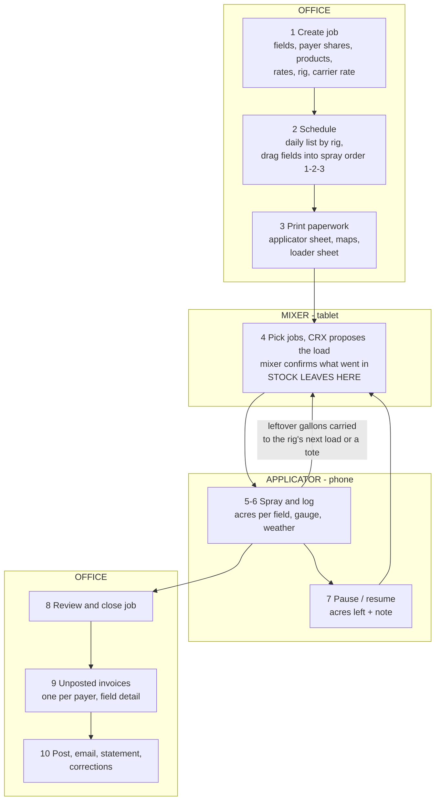
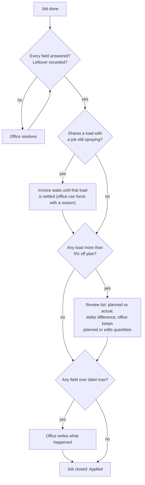
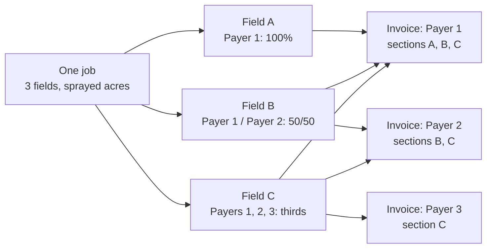

# CRX field application: SPEC (what Mason wants, scheduling to posted invoice)

**Master copy. Every decision here is Mason's newest answer; older answers that conflicted were removed on 2026-11-24 (Mason: "my newest answers beat old answer so remove conflicting older answers").** Git history keeps the old versions. If Mason answers something new, change this file in the same PR and delete the answer it replaces.

Other master files: `CONTRACT-who-pays.md`, `CONTRACT-batch-stock.md`, `CONTRACT-field-billing.md` (how money, stock and payers behave), `BUILD-PLAN.md` (order, lanes, gates, what goes live when), `SCENARIOS.md` + `scenarios-calc.py` (the exact numbers). When they disagree, this file wins, then the contracts, then the build plan. Current code says what exists today.

Mason's private review folder holds an older working copy with customer data; this file replaces it as the design. Made-up numbers only here.

**Standing rules (Mason):**
- **Don't over-engineer.** Flags and notes, not blocks. No extra crew or office steps.
- **Field billing follows the chemical-sale billing rules** for rounding and splitting (2026-11-24). Section 9.
- **Core first** (by February 1, 2027), the rest before the April rush. No reporting features until the system is built.

Tags like [D1], [GR4] point to the decisions register (section 10). [ENGINEERING] is a technical choice Claude makes. [SPRING] is agreed but not in the February version.

---

## 1. The whole flow

**The three rules everything hangs on:**
1. **Stock leaves once, when the mixer confirms a load** [D1]. Nothing after that touches stock; it moves *solution* (mixed product already off the shelf).
2. **Each field bills the rate of the load that actually sprayed it × acres actually sprayed, split by that field's payer shares** [D1, Sol 4/5]. Never planned acres [M5].
3. **Each payer gets one invoice per job, with field detail inside** [D4, G2]. Loads and tanks are internal.

---

## 2. People and what each one does

| Person | Login | Does | Does not |
|---|---|---|---|
| **Office** (admin, sales rep; the bookkeeper uses an admin login [F1]) | admin / sales_rep | Creates and schedules jobs, prints paperwork, reviews and closes jobs, approves waste and extra visits [D11], edits and posts invoices. **Any rep may edit any field draft and post any field invoice set** [F2]; commission comes from the rep set on each payer's customer record [Sol 74] | — |
| **Mixer** | The mix-site tablet stays signed in on a mixer-only account; the mixer taps their name on each load [GR4]. If that account is not ready, mixers sign in with their own login [2026-11-24] | Picks jobs, confirms each load's real contents, edits the load's mix, adds to or corrects a load, logs leftover | Approve waste, see money screens |
| **Applicator** | applicator | Sprays, logs acres per field, gauge, weather, times and crew; pauses with a note; taps Job done [GR3] | Close the job, approve waste, bill |
| **Tender driver** [SPRING] | Any of the four logins [Q5] | Tender and sprayer fills and balances | — |

[ENGINEERING] One shared "office staff" check decides who counts as office in field billing, so a bookkeeper role later is a one-place change [F1].

---

## 3. What CRX keeps a record of

Every record keeps who changed it and when, and **never overwrites history**: corrections are added, not edited over.

| Thing | What it holds |
|---|---|
| **Field** | Boundary, crop (map colour), acres, **payer shares**: a product share set and an application share set, each exactly 100%, with history by start date [A1, Q3]. Archived, never deleted [Q5] |
| **Job** | Fields with planned acres (editable before mixing), products with rate and unit, carrier (water) rate per acre, rig, service charge, tags, job date, dispatch date, notes, prices (locked quote or booking prices carry forward) |
| **Load** (a mixed batch) | Planned and confirmed amount of each product, water and finished gallons, who mixed (name) and which account confirmed, which job(s), leftover gallons at the end. **Keeps its own mix forever** [Sol 4]. Added to or corrected only by a new revision with a reason [Sol 31]. **The only event that takes stock** [D1] |
| **Work entry** | Job, field, the load(s) that sprayed it [Sol 2], applicator, rig, date, start/end time, acres sprayed, gauge reading when a load finishes ("ran dry" / X gal left) [Q11], weather, crew, notes; for an unfinished field, acres left + resume note [ops S12] |
| **Review item** | Why the job needs the office: >5% rate gap, missing field record, mix differs from recipe, stock short [Sol 32], possible duplicate work entry. Label max and extra acres show for information [Sol 3, 37] |
| **Field invoice** (unposted → posted) | One per payer per job: field sections, line items, per-line share overrides, "Shared with" note [Q9] |
| **Equipment** [SPRING] | Tenders, sprayers, totes with capacity and balances [ops S04–S09] |

---

## 4. Stage by stage

### Stage 1: Create the job (office)

1. Start a job directly or from a sent quote or booking; locked prices carry forward [Q1].
2. **Pick fields by payer:** search a grower and see every field they pay any share of; add several growers' fields; earlier picks stay.
3. The map colours fields by crop with a legend; neighbouring fields toggle on and off. [SPRING for the toggle]
4. Each chosen field shows its billing split. A field with no split yet starts **100% to the grower it was added under**, so the crew can spray right away; the office can change it before posting [GR5].
5. Planned acres fill in from the field and can be edited before mixing.
6. **Products:** pick from a list; rate, unit and warehouse fill in and can be changed. **Every rate is per acre** (per-100-gal and %-of-tank products are converted by the office) [GR8]. Over the normal or label rate **warns, never blocks** [Sol 1]. A line can be **"Customer's own / already paid"**: no stock, no charge [Sol 34]. Credit hold makes no difference to field jobs [GR9]. Pickers show grower name and acres beside each field [Sol 57].
7. **Rig and carrier rate:** the rig's normal gallons per acre fills in and can be changed for this job; every printout and calculation uses the job's value, labelled when changed.
8. One application service charge per job [D7]. **No flat fees on field jobs** [Sol 67]. Two rigs billed on one job is later; the design must not rule it out [D7].
9. Tags and job date. Save → **Scheduled**.

### Stage 2: Schedule and dispatch (office)

1. **Daily board: a list by rig**, list first; the existing Map tab stays [Q12]. Filters by tag, date, status; tick several jobs to print or map together.
2. **Spray order:** drag and drop fields into order, numbered 1, 2, 3 **per job** (each job restarts at 1) [Q13, Sol 86]. Shown on maps, sheets and the phone. No job priority.
3. Dispatch date is separate from the job date and the spray (legal) date.
4. Assign applicator(s) and rig; changing the rig later is allowed.
5. "Scheduled" does not mean "mixed"; the mixer decides [ops S13].

### Stage 3: Paperwork (office prints)

1. **Applicator sheet:** fields, map pages, directions link, tank contents, safety information. Options: **hide tank contents**, **map pages only**. Safety information (REI, PHI, signal word) always prints.
2. **Maps:** combined, per field, or both; field numbers are the spray order. Printing what's in the map window and an ink-saver option are [SPRING].
3. **Loader sheet:** rate per acre, total of each product, **water to add** and **finished gallons** labelled separately [Sol 62], in loader units ("58 GL 7.68 FL OZ"). Views: one big batch, or loads sized to the sprayer's tank.
4. Printed load sheets for anyone on paper; paper work is entered on the tablet afterwards [G3.1].
5. A product with no EPA number prints a dash; "Unknown" only when a registered product's number is missing [KI-206].

### Stage 4: Mixing (mixer, tablet) — STOCK LEAVES HERE

1. The mixer screen lists scheduled jobs, grouped where the mix and rate match so one load can serve them [ops S10]. The mixer **picks the job(s)** [ops S13].
2. For each job: acres still to spray and solution still needed.
3. **Leftover from the rig's last load** [GR2]: the gallons logged as left on that rig's last load show as **carried in**, and CRX proposes that much less. Leftover nobody can use goes to a tote and is dealt with outside CRX [Sol 9].
4. CRX proposes the load (each product's amount, water, finished gallons, sized to the tank); the mixer can change it before mixing.
5. **Confirm actuals:** the mixer confirms or types what really went in and taps their name. Then **Add to load** (product really added later) or **Correct load** (a typo, with a reason) [Sol 31].
6. **Stock leaves now, once, from the confirmed amounts** [D1], from the job's warehouse. Customer's own / already paid product takes no stock [Sol 34]. **Stock short:** the load still saves, stock may go below zero, the office gets a flag [Sol 32]. The job's held stock is released when the job closes (partial release per load is [SPRING]).
7. **Mix differs from recipe** [Q2]: the mixer can remove, add, substitute or change an amount. The original recipe stays in history; the job is flagged for office review. **Each load keeps its own mix** [Sol 4/5]: fields sprayed with X bill X; fields sprayed with Y bill Y. A substitute with no price is flagged for the office to price [M9].
8. A load can serve several compatible jobs [ops S10]. A load with grower-supplied product used on another customer's job is allowed and flagged [Q3].

### Stage 5: Tenders and sprayer fills [SPRING]

Tender and sprayer balances, fill to full / partial fill / correct balance, any-container-to-any-container moves of the same mix, totes as containers, one mix per tender, spills recorded as a balance correction with a note [ops S04–S11, Q10, Q14]. Until then the leftover rule in stage 4 step 3 is the whole leftover feature [GR1, GR2].

### Stage 6: Spraying and logging (applicator, phone)

1. Open the job and field. **Now** buttons for start and finish times. Weather fills in for the start time and can be edited [Sol 52]. Directions link to the field.
2. **One work entry per field per day** (unless the office keeps a real second pass): acres sprayed (planned acres pre-filled), rig, date, crew, comments, linked to the load that sprayed it [Sol 2]. One tankful over several fields: acres per field.
3. **Extra acres** (more than planned) are logged and bill like any sprayed acre; shown to the office for information [Sol 37].
4. **Two entries that look the same** (same field and day, for example phone plus paper) warn; the office removes one or keeps it as a real second pass [Sol 28]. **A real second pass bills its own service and fuel acres** [M8].
5. **When a load finishes or the sprayer empties:** gauge reading, "ran dry" or "X gal left" [Q11]; leftover is carried to the rig's next load or a tote [GR2, M4].
6. Anything unusual (drift, wrong field, water-only top-up) is a **note** [Sol 20, 63].
7. Restricted-use products ask for the extra fields staff set, per state (two or more states) [D6, Sol 15]. **The spray record prints per field any time** [Sol 18].
8. **Extra field** asked for by the grower: the applicator adds it on the phone and logs acres; flagged for the office to confirm field and split [GR6].
9. **Job done:** any applicator on the job taps it; when every field has acres or is closed the job goes to office review. The office can also mark it [GR3].
10. An applicator can fix their own entry until the office closes the job; after that only the office, with a reason [ENGINEERING].
11. Phones work without signal and sync later [Q7] [SPRING].

### Stage 7: Pause and resume

1. An unfinished field: acres done + resume note [ops S12]. **The job stays open across days**; every day adds entries [G1].
2. The job shows planned, sprayed and remaining acres per field and solution still to mix; the next load includes "X acres to finish on field Y" [G1].
3. **Never sprayed** (rain, grower stops partway): the office **closes the remaining acres with a reason**; they are not billed [D1b, Sol 11]. **Cancel is only for a job with zero acres sprayed** [Sol 11].
4. **Rained out after mixing:** the office ends the job with nothing billed; the load stays recorded (its stock really left) and its contents are carried to the next load or a tote; a note is optional [M4].

### Stage 8: Office review and closing the job

The job reaches **Ready for review** when Job done is tapped [D8, GR3]. **A clean job closes with one click** [Sol 53].

| Check | Rule |
|---|---|
| **Every field answered** | A field with no record is **missing**. A recorded **0** is a real answer. Missing never becomes planned acres. |
| **Leftover recorded** | Each load ran dry, or its leftover gallons are carried to the rig's next load or a tote. Gauges are rough: **a gap up to 5% (office-adjustable) passes with no office step** [Sol 25]. |
| **Shared load** | A job sharing a load with a job still spraying is field-complete; its invoices wait until that load is settled; the office can force it with a reason [Sol 6]. |
| **Rate check per load** [G4, Q11] | Actual rate = product used from the load ÷ acres it sprayed (a load shared by jobs gives them one rate). More than **5% (office-adjustable)** off plan puts the job on the review list with planned vs actual and the dollar difference. The office keeps the planned rate or edits the quantities with a reason. (One-click "bill actual used", spread over the acres that got that load [G5], is [SPRING].) Zero-acre jobs skip it [Sol 60]. |
| **Label maximum** [G6] | Checked per field [Sol 3]. The office writes what happened; the legal record keeps the actual rate. A warning, never a block. |
| **Mix differed from recipe** [Q2] | The office reviews it. It bills what went in the tank unless the office chooses otherwise, and prices any unpriced substitute [M9]. |
| **Waste and extra visits** [D11, Q6] | Approved by any office role with a reason. Not billed unless the office adds it with a reason. |
| **Remaining acres** | All sprayed, or closed with a reason. |

When every check passes, the office closes the job → **Applied**. An optional "job done" email (off by default) goes to every payer, each seeing only their own fields [Q8, D5, Sol 76].

**Office views** [Sol 77, 80]: per job, stock that left at each load vs gallons sprayed vs gallons billed, differences highlighted; a "sprayed, not billed" list.

### Stage 9: Unposted invoices (CRX builds, office reviews)

1. **Made only when the job is closed** and every load it shares with another job is settled [G2, Sol 6]. One unposted invoice per payer, listing every field that payer shares on the job [D4].
2. **How each line is worked out** (exact numbers: `SCENARIOS.md`):
   - **Quantity:** each product's gallons on a field = the rate of the load(s) that sprayed it × the acres each sprayed there [D1, Sol 4/5]. Service and fuel = the field's sprayed acres [Sol 68]. Each real pass counts [M8].
   - **Price:** locked quote or booking prices carry forward. Otherwise **one price per product for the whole job: the price on the job's first spray day** [Sol 66]. One price per product per job even when payers have different price agreements; per-payer prices are [SPRING] [M2]. A substitute with no price holds the whole payer set until the office prices it [M9]. Line by line, never a flat price per acre.
   - **Money, the chemical-sale way (Mason, 2026-11-24):** each product is priced **once per job** (total gallons × price, rounded to the cent once), so the job never bills more or less than gallons × price (1 gal at $10.01 over two equal fields bills $5.01 + $5.00). That total is shared across the fields; then each field line is shared across its payers **exactly as chemical-sale split invoices do**: every payer except the main customer gets their share rounded down, and **the main customer (the job's grower) gets the rest**; if the main customer has no share of that line, the largest share gets it.
   - **Shares:** products use each field's **product shares**; service and fuel use its **application shares** [A1, Q6]. The split is the one **in force on the day that field was sprayed** [Sol 41].
   - **No flat fees, no sales tax on field work** [Sol 67, Sol 48]. Customer's own / already paid product prints at no charge [Sol 34].
3. **Each invoice shows** field sections (name, acres, rate per acre, spray dates), lines labelled **"field total"** and **"your share"**, a **"Shared with"** note, and only that payer's fields; never other payers' prices or CRX's cost [Q9, Sol 71]. **No zero-dollar invoices** [Sol 75].
4. **Office edits before posting** (any rep or admin [F2]):
   - Per-line share override (for example one payer 100% of one product); payers can only be those on the field's split or the job's office split [Q1]; every payer's cents still add up to the line.
   - Price or quantity edits **with a reason** [D9, B03].
   - **Prices stay fixed** once the draft is made; an explicit, logged **price refresh** changes them and never touches locked quote or booking lines [B02, Sol 43].
   - A field's split changed after the draft was made reaches the draft only through a logged **split refresh** [Q3].
5. **Invoice date** defaults to the posting day; the office can set it earlier before posting. Due date follows each payer's terms [GR7].
6. Print options: maps on or off, ink saver, colour [SPRING].
7. **Overlap warning:** a hand-typed invoice for the same field, date and product as a job warns; a note is optional [B04]. Billing the same job's work twice is refused.

### Stage 10: Post, send, statements, corrections

1. **Post** the payer set: any admin or sales rep [F2]. **The whole set posts or none of it does** [Sol 13], the same way chemical-sale split groups post.
2. Print or email each payer's invoice (email only [D5]); it shows on that payer's monthly statement.
3. **Corrections** [D9, Q10]:
   - **Unposted:** edit with a reason.
   - **Posted, no money applied, month open:** unpost the **whole payer set**, fix, repost, with a reason. "No money" = no payment, prepay, credit or write-off on any invoice in the set [Sol 45]. Any invoice whose printed amount changes is marked **"Corrected"**; the office chooses whether to re-send [M3].
   - **After money or month close:** credit and rebill **only the invoices whose dollars changed** [M3].
   - Correcting a posted job's spray record flags its invoices; it changes nothing by itself [Sol 47].
   - Stock is corrected only by a new reversing entry.
4. **First real multi-payer job is checked by hand** before field billing is on for everyone [D12], with a short checklist [Sol 51].

### Going live

1. **Chem Man keeps billing field work until CRX billing passes its checks; then Mason picks the billing switch-on date.** Work sprayed before that date is billed in Chem Man and marked so in CRX; CRX bills work sprayed on or after it [M5, GR11, 2026-11-24]. CRX never bills planned acres.
2. Jobs, mixing and acres move to CRX before billing does, in slices (`BUILD-PLAN.md`) [2026-11-24].
3. **Fields from Chem Man:** Mason exports a file; it is imported on staging, spot-checked by the office, then imported live [GR10], after Taha's one-time live data reset has run.
4. **Open Chem Man jobs:** sprayed work is billed in Chem Man; unsprayed acres become new CRX jobs by hand [GR11].
5. Old test jobs are deleted (Mason's yes at the time); real jobs are archived [D12, Sol 50].

---

## 5. Job status

`Scheduled` → `In progress` (first load or work entry) → `Paused` (optional) → `Ready for review` (Job done) → `Needs office decision` (a check failed) → `Applied` (closed) → `Invoiced (unposted)` → `Posted`. A posted set can go back to unposted (no money, month open).

`Cancelled`: only with zero acres sprayed and no confirmed load [Q9, Sol 11]. Rained out after mixing: ended with nothing billed [M4]. Stopped partway: remaining acres closed, then review and billing.

---

## 6. Worked example (made-up numbers)

Job: fields A (51 acres, 1 payer), B (110 acres, 50/50), C (71 acres, thirds). Product X at 32 fl oz/acre, carrier 15 gal/acre.

1. **Mix:** CRX proposes 58 gal X + 3,422 gal water = 3,480 finished gallons. The mixer confirms. **Stock −58 gal X.**
2. **Spray:** A 49 acres, B 110, C 69 = 228. Ran dry.
3. **Rate check:** 58 gal over 228 acres = 1.75% over plan, under 5%: no review.
4. **Bill:** 32 fl oz × 228 acres = 57 gal of X at one price, priced once for the job, shared across A, B, C, then across each field's payers. The 1 gal mixed but not billed shows on the review screen.
5. **Invoices:** three, one per payer; payer 1's has three field sections. Exact cents: `SCENARIOS.md` S1.

---

## 7. Feature list: February vs spring

**February (core, GR1):** stages 1–4 (no partial hold release), 6 (no offline), 7, 8, 9, 10, going live. Per-field items: field picker by any payer share; spray order; job carrier rate; paperwork fixes; mixer tablet with name pick, per-load mix edits, add/correct, leftover carried to the rig's next load; stock at the load; work entries per field per day with Now buttons, weather, gauge, duplicate warning, extra field, Job done; review checks and office views; per-payer invoices the chemical-sale way; posting as a set; corrections; Chem Man until the switch-on date.

**Spring, before April:** tender and sprayer balances, fills and moves, totes as containers, offline phones, per-payer prices on one field [M2], one-click "bill actual used" [G5], leftover claim tracking (carried mix checked against the next job's recipe and customer), partial hold release per load, a possible-duplicate-load flag, crop-coloured map neighbour toggle, map print options, blend-ticket billing on the same rules, orders and deliveries reading field shares.

**Later:** two rigs billed on one job (D7), applicator licence per entry, sensitive wind direction, power and tree lines, map export, sensitive-crop layer, text messages, bookkeeper role (F1). **Reporting is not built until Mason asks** [GR12].

---

## 8. Behind the scenes (Claude owns these)

1. One billing calculation for every route that bills field work.
2. Every save is retry-safe: a double tap or resend never makes two loads, two stock moves or two invoices.
3. Rules and access are enforced in the database, not only on screen.
4. Real billing stays off in production until every scenario in `SCENARIOS.md` passes as the real roles; the first real job is checked by hand.

---

## 9. Same rules as chemical sales (Mason, 2026-11-24)

Field invoices use the chemical-sale split rules already live in CRX (`_bill_split_line_shares`, `20261215110000`, applied 2026-11-09), so a customer sees one way of rounding:
- A line is quantity × price, rounded to the cent once.
- Each payer except the main customer gets their share **rounded down**; the main customer gets the rest. If the main customer has no share of a line, the largest share gets the rest.
- A payer's quantity is rounded down to hundredths (4 decimals for a share under 0.01) the same way, the main customer taking the rest.
- Ties for the largest share go to the lowest customer id. Credits (negative amounts) round every other payer's share down, away from zero, and the main customer takes the rest.
- The payers' invoices are one group: they post, unpost and are deleted together.
- A line with no price holds the group (as a price-later sale does).

Field-only differences, each Mason's own answer: field shares are stored exactly (thirds are 33.333334% / 33.333333% / 33.333333%), the job's customer (the grower) is the main customer, a product over several fields is priced once for the job and then shared across the fields the same round-down way, there is no sales tax and no flat fee on field work, and any rep may post a field set.

---

## 10. Decisions register (newest answer only)

Sol numbers without a row here are reviewer finding ids kept for traceability; the sentence they tag is the rule.

| ID | Decision |
|---|---|
| D1 | Stock leaves once, at load confirmation, from the confirmed amounts. Bill the load's rate × sprayed acres |
| D1b | Acres never sprayed are closed by the office with a reason and not billed |
| D4 | One invoice per payer per job, field detail inside |
| D5 | Email only |
| D6 | Restricted-use extra fields set by staff; keep it small |
| D7 | One service charge and one rig per job for now; don't rule out two |
| D8 | Applicators mark the job done; the office reviews, closes and posts |
| D9 | Draft: edit with a reason. Posted: unpost the whole set while no money and month open. After that: credit and rebill |
| D11 | Waste and extra visits approved by admin or rep (the bookkeeper uses an admin login) |
| D12 | Delete test jobs, archive real ones (Sol 50); first real multi-payer job checked by hand |
| F1 | No bookkeeper role yet; admin login |
| F2 | Any rep edits and posts any field invoice set |
| G1 | Unsprayed acres stay on the same job across days |
| G2 | Invoices when the whole job is closed; none mid-job |
| G3.1 | Mixer works on a tablet at the mix site; loads also print |
| G4 | 5% rate check; per-load numbers shown |
| G5 | One-click "bill actual used" per load, spread over the acres that got that load [SPRING] |
| G6 | Over label max: office writes what happened; the legal record keeps the truth |
| A1 | Each field has product shares and application shares, each exactly 100%; a payer may be 0% on one side |
| B02 | Draft prices stay; only a logged price refresh changes them |
| B03 | The office may enter measured usage with a reason |
| B04 | A hand-typed invoice overlapping a job warns; a note is optional |
| Q1 | Payers on a field come only from its saved split (or a job's office split); add someone to the field first (2026-11-08). Jobs start directly or from a quote or booking (2026-11-23) |
| Q2 | Mixer edits the load's mix; the job is flagged; bill what went in the tank |
| Q3 | A field's split can change from any date the office picks; drafts keep theirs until a logged refresh. Grower-supplied product on another customer's job: allowed, flagged |
| Q5 | Fields: admins and reps archive, only admins restore, blocked while work is open. Tender driver: any login [SPRING] |
| Q6 | Fuel follows the application shares. Wasted solution not billed unless the office adds it; never just dumped |
| Q7 | Offline phones sync later; a job can't close while entries wait [SPRING] |
| Q8 | Optional "job done" email, off by default, to every payer, own fields only |
| Q9 | Each payer's invoice shows who shares the bill. Cancel only at zero acres sprayed |
| Q10 | A posted set can be edited (unpost, fix, repost) until money is applied or the month is closed |
| Q11 | A shared load's use is split across its jobs by acres |
| Q12 | Daily board is a list by rig; Map tab kept, list first |
| Q13 | Drag-and-drop spray order 1, 2, 3 per job; no priority |
| Q14 | No spill button |
| S01–S16 | Codex's operating answers (each applicator logs their own work; same job across days; tenders carry one mix; mixer picks jobs; loads can serve several compatible jobs) |
| Sol 4/5 | Each load keeps its own mix; each field bills the load that sprayed it |
| Sol 6 | Shared load: invoices wait until it is settled; office can force |
| Sol 9 | Unusable leftover goes to a tote, handled outside CRX |
| Sol 11 | Grower stops partway: close the remaining acres |
| Sol 25 | Gauge gaps up to 5% pass with no office step |
| Sol 32 | Stock short: allow and flag |
| Sol 34 | Customer's own / already paid: no stock, no charge |
| Sol 37 | Extra acres bill as sprayed, no office check |
| Sol 41 | Split on the day sprayed; editable before posting |
| Sol 47 | A spray-record correction after posting flags invoices; it changes nothing by itself |
| Sol 48 | No sales tax on field work |
| Sol 75 | No zero-dollar invoices |
| Sol 66 | One price from the first spray day; locked prices win |
| Sol 67 | No flat fees |
| Sol 74 | Commission from the rep on the customer record |
| Sol 86 | Field numbering restarts per job |
| GR1 | Core by February 1; tenders, balances, offline, totes before April |
| GR2 | Leftover logged at the end; the rig's next load shows it as carried in |
| GR3 | Any applicator on the job taps Job done; office can too |
| GR4 | Tablet stays signed in; mixer picks their name |
| GR5 | No split: 100% to the grower the field was added under |
| GR6 | Applicator adds an extra field on the phone; flagged |
| GR7 | Invoice date = posting day; office can set an earlier date before posting |
| GR8 | Every rate entered per acre |
| GR9 | Credit hold ignored for field jobs |
| GR10 | Fields imported once from a Chem Man export file |
| GR11 | Sprayed Chem Man work billed in Chem Man; unsprayed acres become CRX jobs |
| GR12 | No reporting features yet |
| M2 | Per-payer prices exist but wait for spring; February bills one price per product per job |
| M3 | An invoice whose printed amount changed is marked "Corrected"; office chooses to re-send; credit and rebill only when dollars changed |
| M4 | Rained out after mixing: ended with nothing billed; load stays; contents carried or to a tote |
| M5 | Chem Man bills field work until CRX passes its checks; never bill planned acres. **Now the plan, with a switch-on date (2026-11-24)** |
| M6 | Sol capped at two rounds per plan; leftovers to Mason |
| M7 | No build session starts until Mason says so |
| M8 | Each real pass bills its own service and fuel acres; look-alike entries warn |
| M9 | A substitute with no price holds the whole payer set |
| 2026-11-24 a | **Rounding and splitting follow chemical sales** (section 9); a product is priced once per job, never more than gallons × price. |
| 2026-11-24 b | Go live in slices; billing last, on a switch-on date |
| 2026-11-24 c | February scope cut: partial hold release, leftover claim tracking, one-click bill actual used, duplicate-load flag move to spring |
| 2026-11-24 d | If the mixer tablet account is late, mixers use their own logins |
| KI-206 | No EPA number prints a dash |
