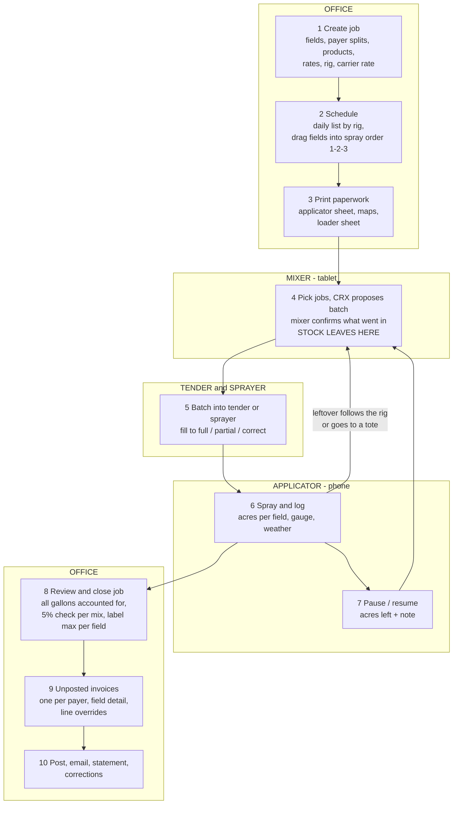
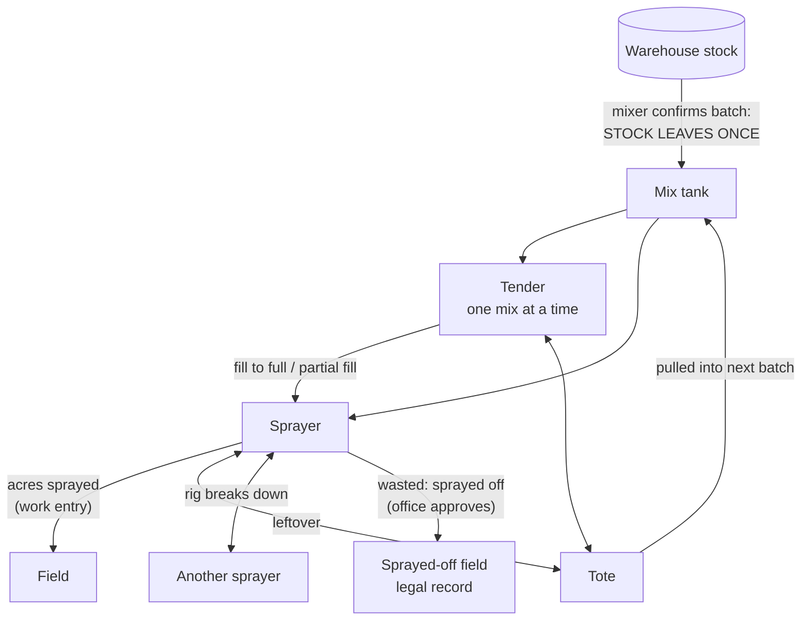
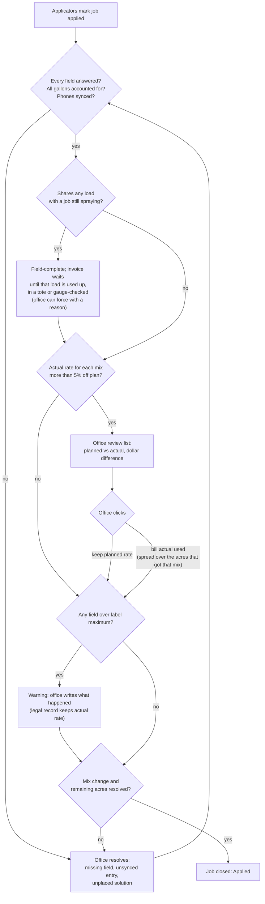
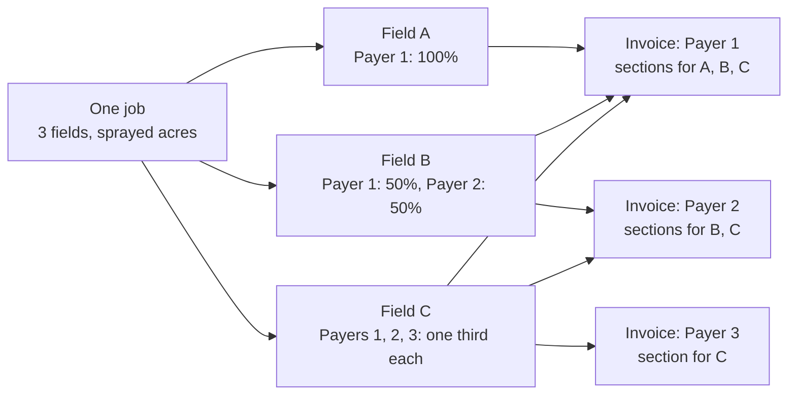
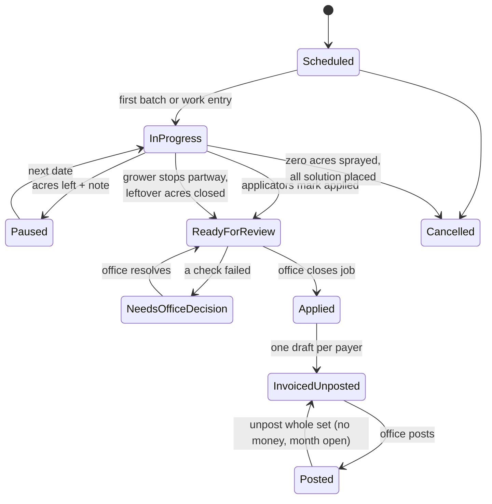

# CRX field application: SPEC (the whole workflow, scheduling to posted invoice)

**Repo copy of the field application master design (settled 2026-11-23, reviewed by Sol and grilled 2026-11-24).** Mason keeps the working master in a private review folder that also holds customer data; this copy carries the design only, with made-up numbers, and is the version build agents use. If the two ever differ, Mason's latest answer wins: record it here in the same PR that builds on it.

**Design only.** What CRX already has is in `GAP-CHECK.md`; how it gets built is in `WAVES.md`.

Decision IDs: D/F/G/KI (Claude, 2026-11-23), S/B (Codex, 2026-11-20/23), Q1–Q14 (final questions), Sol N (Sol review, see `SOL-FINDINGS-PLAN.md`), GR1–GR12 (grill, 2026-11-24).

**How to read the tags:**
- **[D1], [S10], …** marks something you already decided. The ID points to where.
- **[Q1]–[Q11]** are your answers to the final questions (section 9).
- **Appendix A** at the end lists **every** question Codex and Claude asked you, with your answer, including the last three (Q12–Q14).
- **[GR3]** points to a grill question answered 2026-11-24 (section 9c).
- **[Sol 21]** points to a finding in Sol's 2026-11-24 review and how it was settled (`SOL-FINDINGS-PLAN.md`).
- **[ENGINEERING]** is a technical detail I decide, unless you want a say.
- **[LATER]** was agreed as a future item and is not in the first version.

---

## 1. The whole flow on one page



The same flow in text, for reading without the diagram:

```
 OFFICE                    MIXER (tablet)            TENDER / SPRAYER           APPLICATOR (phone)          OFFICE
 ───────                   ──────────────            ────────────────           ──────────────────          ──────
 1 Create job          →   4 Pick jobs from      →   5 Batch goes into a    →   6 Pick up solution     →   8 Review & close job
   fields, splits,           the schedule,             named tender or            (fill to full /            all solution accounted
   products, rates,          CRX proposes the          straight to a sprayer      partial / correct)         for, 5% check,
   rig, carrier rate         batch; mixer                                         spray, log acres per       label max per field,    
 2 Schedule & dispatch       confirms actuals      ←── leftover / tote ────────   field, gallons left        waste approvals
 3 Print paperwork           STOCK LEAVES HERE                                  7 Pause / resume:         9 Unposted invoices:
   (applicator sheet,                                                             acres left + note          one per payer, field
   maps, loader sheet)                                                                                       detail, line overrides
                                                                                                           10 Post → print / email →
                                                                                                             statements; corrections
```

**Your standing rule (2026-11-24): don't over-engineer.** Keep the crew and office free and flexible: flags and notes, not blocks.

**The three rules everything hangs on:**
1. **Stock leaves once, when the mixer confirms a batch** [D1]. Nothing after that (pickups, spraying, leftovers) touches stock. Those steps move *solution*, which is mixed product already off the shelf, between named containers.
2. **Billing defaults to the rate of the mix that actually sprayed each field × acres actually sprayed, split by each field's payer shares** [D1, G5, Sol 4/5]. Each load keeps its own mix, so a mid-job change never rewrites earlier fields. If the job's actual rate is off by more than 5%, the office decides [G4]. If it is over the label maximum, the office writes what happened [G6].
3. **The grower only ever sees one invoice per payer per job, with field detail inside** [D4, G2]. Loads, batches and tenders are internal.

---

## 2. Where your two sets of answers differed: SETTLED

You answered the Codex questions and the Claude questions in separate sessions. Most answers fit together. These five points differed. **All five are settled (Mason, 2026-11-23, Q4, refined by Q6 and Q11).** The last column is the final rule; the rest of this document follows it.

| # | Claude set said | Codex set said | Final rule |
|---|---|---|---|
| J1 | Each load is its own ticket linked to **one job** [G3] | One tender batch can supply **several jobs and customers** with the same mix and rate [S10, S11] | A **batch** is what the mixer confirms. A batch can serve one job or several compatible jobs. Each job still gets its own work records and its own invoices. The grower never sees batches. |
| J2 | Leftover "follows the rig" or goes into a **tote** [G3.5] | Full **tender and sprayer balances** with fill to full / partial / correct [S04–S09] | Same idea, with the Codex version as the fuller one. Every **container** (mix tank, tender, sprayer, tote) shows how many gallons of which mix it holds. Leftover on a rig is simply that sprayer's balance. A tote is a container with no wheels. Containers hold solution, **not stock** (both sets agree). |
| J3 | Applicator logs **each load**: acres + "ran dry" / "X gal left" [G3.4] | Applicator logs **work entries**: job, field, date, acres, solution used [S01–S03] | The applicator logs work per **job + field + day**. The sprayer gauge ("ran dry" or "X gal left") is read when a mix finishes or the sprayer empties, not per job; a shared mix's use is split across its jobs **by acres** [Q11]. The rule "can't bill until every load is logged" becomes: **can't bill until every gallon mixed for the job is accounted for** (sprayed, still aboard, moved to another job, put in a tote, or sprayed off and recorded [Q6]). |
| J4 | CRX creates the blend ticket **from the job** [D1 step 1] | The **mixer picks jobs** from the schedule; scheduled ≠ mixed [S13] | The mixer picks one or more jobs, and CRX then proposes the batch from them (recipe × acres, minus solution already mixed and still aboard). |
| J5 | B05: payer-invoice grouping undecided; B06: corrections after billing need more thought (Codex, earlier) | D4: one invoice per payer with field detail; D9: correction rules "I agree" (Claude, 2026-11-23) | The later answers **win: D4** (one invoice per payer, field detail inside) **and D9** (draft edit with reason / unpost whole payer set / credit and rebill). B05 and B06 are closed. |

---

## 3. People and what each one does

| Person | Login today | Does | Does not |
|---|---|---|---|
| **Office** (admin, sales rep; bookkeeper uses an admin login for now [F1]) | admin / sales_rep | Creates and schedules jobs, prints paperwork, reviews work, closes jobs, approves waste and extra visits [D11], runs the 5% and label-max reviews [G4, G6], edits and posts invoices. **Any rep may edit any draft and post any field invoice** [F2]; commission comes from the rep set on the customer in customer setup, whoever entered the job [Sol 74] | — |
| **Mixer** | Any admin, sales rep or applicator login; no new role [D1a] | Picks jobs, confirms each batch's actual contents, chooses the destination container, tops up a same-mix tender [S11], moves solution to another compatible job with a recorded reason [S14], marks leftover "use it" or "wasted" (wasted solution goes into a tote or is sprayed off, never dumped [Q6]) | Approve waste (only office can) |
| **Applicator** | applicator | Picks up solution, sprays, logs acres per field, logs gauge reading, weather, times and crew, pauses and resumes with a note [S12] | Close the job, approve waste, bill |
| **Tender driver** | **[Q5, Mason 2026-11-23]** usually a driver or applicator, but a sales rep or admin drives when it is busy, so **any of the four logins** can do tender work | Sees tender and sprayer balances; records fills from the tender into sprayers | On a driver or applicator login: edit jobs, approve or bill. A rep or admin driving keeps their normal office rights |

**[ENGINEERING]** One shared "office staff" check decides who counts as office everywhere in field billing. Adding a bookkeeper role later is then a one-place change [F1].

---

## 4. The building blocks (what CRX keeps a record of)

In plain words, these are the "things" the system needs. Each one keeps who changed it and when, and **never overwrites history**: corrections are added, not edited over.

| Thing | What it holds |
|---|---|
| **Field** | Boundary, crop (drives the map colour), acres, **payer splits** (who pays what %), sensitive-wind direction [LATER 3c], power lines and tree lines [LATER 3d] |
| **Job** | Fields with planned acres (editable before blending, "five acres light"), products with rate and unit, carrier (water) rate per acre, application rig, service charge, tags, job date, dispatch date, notes and instructions, prices (locked quote or booking prices carry forward [2026-11-22 rule]) |
| **Equipment / container** | Name, type (mix tank / tender / sprayer / tote), capacity, has a sight gauge or not [S06]. **Current mix and gallons aboard, shown as estimated, with the last confirmed reading** [S08] |
| **Batch** (a mixed load) | Planned vs confirmed amount of each product, water added and finished gallons, who confirmed and when, which job(s) it is for, destination container. **Keeps its own confirmed mix forever**: a later recipe change never rewrites it [Sol 4]. Can be corrected (with a reason, as a reversing entry) or added to [Sol 31]. **This is the only event that takes stock** [D1] |
| **Solution movement** | From container → to container, gallons, type (fill to full / partial fill / correction / move to tote / sprayed off as waste), who and when. **Never touches stock** |
| **Work entry** (applied record) | Job, field, **the load(s) that sprayed it** (so the product and rate are known with no extra typing [Sol 2]), applicator, rig, date, start/end time, acres sprayed, gauge reading when a mix finishes ("ran dry" / X gal left) [Q11], weather (temperature, wind speed and direction), crew (tender driver, mixer), notes, and for an unfinished field: acres left + resume note, photo or map mark optional [S12] |
| **Review item** | Why the job stopped: >5% rate gap, missing field record, mix differs from recipe, stock short [Sol 32]. Over label max and extra acres are shown for information, not as stops [Sol 3, 37]. Who resolved it, the choice, and the written reason |
| **Field invoice (unposted → posted)** | One per payer per job: field sections, line items with per-line share overrides, "Shared with" note, prices fixed when the draft is made [B02] |

---

## 5. The workflow, stage by stage

### Stage 1: Create the job (office)

1. Start a job **[Q1, Mason 2026-11-23: both]** either directly or from a sent quote or booking. Prices from a locked quote or booking carry forward.
2. **Pick fields by payer:** search a grower and see every field they pay *any* share of, including fields where they are not the main payer. Search a second grower and add their fields too; earlier picks stay picked ([00:17]–[03:20]).
3. The map colours fields by crop (corn yellow, beans green) with a legend. You can toggle neighbouring fields on and off.
4. The job lists each chosen field with **its billing split shown** (for example 1 payer, 2 payers 50/50, 3 payers by thirds).
4a. **A field with no payer split yet** starts 100% to the grower it was added under, so the crew can spray right away; the office can change it any time before posting [GR5].
5. Planned acres fill in from the field and **can be edited before blending** ("five acres light or heavy"), so the mixer knows what to mix.
6. **Products:** search or pick from a list. Normal rate, unit, warehouse or vendor fill in, and all can be changed. **Every rate is per acre**: a product labelled per 100 gallons or as a % of the tank (AMS, surfactant) is converted by the office and typed per acre [GR8]. A payer on credit hold makes no difference to field jobs [GR9]. **Over the normal or label rate shows a warning and never blocks** ([04:49], kept [Sol 1]). A product line can be marked **"Customer's own / already paid"** (grower-supplied, or bought earlier on an invoice that already took it out of stock): no stock, no charge [Sol 34]. Field pickers show the grower name and acres beside each field name [Sol 57].
7. **Rig and carrier rate:** pick the sprayer. Its normal gallons per acre fills in (for example 15) and can be changed for this job (for example 20). **Every printout and calculation uses the job's carrier rate**, and a changed value is labelled so nobody wonders why the numbers differ.
8. Application service charge: one service per job [D7]. **No flat fees on field jobs** (feature removed, Mason 2026-11-24 [Sol 67]). Two sprayers billed on one job comes later [LATER 3j]; the design must not rule it out.
9. Tags (for example "post-emerge") for filtering. Job date.
10. Save. Job status: **Scheduled**.

### Stage 2: Schedule and dispatch (office)

1. **Daily board: a list by rig** [Q12, Mason 2026-11-23]; CRX's existing Map tab stays, with the list shown first [Mason 2026-11-24]. Each rig shows its jobs for the day, with filters by tag, date and status. Tick several jobs to print or map them together [3g].
   - **Spray order:** the office **drags and drops fields into the order they should be sprayed**, numbered 1, 2, 3 … [Q13]. **Numbering is per job: every job starts at 1**, even when three jobs go out to the same sprayer [Sol 86]. That order and those numbers appear on the printed maps, the applicator sheet and the applicator's phone. There is **no job priority** setting; the order is the plan.
2. Set the **dispatch date** (when crews go). It is kept separate from the job date and the application date (the legal and pricing date).
3. Assign the applicator(s) and rig. Changing the rig after dispatch is allowed. A rig change is only an assignment: a container-to-container move is logged **only if liquid really moved** [Q10, Sol 55].
4. "Scheduled" does not mean "mixed". The mixer decides [S13].

### Stage 3: Paperwork (office prints)

1. **Applicator sheet:** fields, map pages, directions link (Google Maps), tank contents, safety information. Options: **hide tank contents** and **map pages only**. Required safety and application information always stays on it.
2. **Maps:** a combined map of all fields, per-field zoomed maps, or both. **What's in the map window is what prints** (zoom out to show roads and landmarks). Field numbers on the map are the **spray order** the office set (1, 2, 3, restarting for each job) and match the sheets [Q13, Sol 86]. Ink-saver option.
3. **Loader sheet (mixer):** rate per acre, total of each product, **water to add** and **finished gallons** labelled separately [Sol 62]. Two views: **one big batch** (whole job in one tender) or **individual loads sized to the sprayer's tank**. Amounts shown loader-style ("58 GL 7.68 FL OZ").
4. Printed load sheets exist for anyone working from paper [G3.1]. Anything done on paper gets entered on the tablet afterwards.
5. **[DECIDED KI-206]** A product with no EPA number prints a dash (—). "Unknown" appears only when a registered product's number is missing. The wording is the same before and after spraying.

### Stage 4: Mixing (mixer, tablet at the mix site) — STOCK LEAVES HERE

**The tablet stays signed in.** When confirming a batch the mixer taps their name from a list, so every batch records who mixed it [GR4]. **[ENGINEERING]** That tablet sign-in can only open the mixer screen (no office, money or customer screens).

1. **Mixer screen:** shows outstanding scheduled jobs, grouped where the **mix and rate match** (the same products and rates per acre, and the same carrier rate) so one batch can serve them [S10].
2. The mixer **picks the job(s)** [S13]. For each job the screen shows: acres still to spray, solution already mixed and still aboard any container (with approximate acres it covers), and **solution still needed**.
2a. **Leftover from the last load** [GR2]: the mixer or applicator logs "X gal left" at the end, and the next batch for that rig shows it as **carried in**, so the mixer mixes less. In the February version this is the whole leftover feature; tender and sprayer balances come in spring. **[ENGINEERING]** Carried-in gallons move to the next job automatically, so the first job's check counts them as moved, not sprayed.
3. **CRX proposes the batch:** each product's amount and total gallons, sized by default to the **space left** in the destination container (a 3,200-gal tender already holding 900 gal of the same mix gets a 2,300-gal suggestion, not 3,200) [G3.2, Sol 21]. **Solution carried in is subtracted**: "X gal carried in from Job ___ on this rig" → **Use it** (mix less) or **Wasted** (it goes into a tote or is sprayed off, never dumped [D11, Q6]; leftover nobody can use goes in a tote and is **dealt with outside the system** [Sol 9]) [G3.5]. A tote's contents can be pulled in the same way.
4. The mixer can change any proposed load before mixing it.
5. **Confirm actuals:** the mixer confirms the proposed amounts or types what actually went in, for each product and total gallons [S15]. Planned and confirmed amounts are both kept, with who and when. After confirming: **Add to batch** (product really added later) and **Correct batch** (a typo, with a reason, saved as a reversing entry) [Sol 31].
6. **Destination:** a named tender, or straight into a sprayer. Topping up a tender **with the same mix** before it is empty is allowed. Each addition stays its own record, and the tender shows the combined total [S11]. **A tender carries one mix at a time** [S05], so a different mix into a non-empty tender is refused. "Same mix" compares the **confirmed** contents; a small difference shows a warning, never a block [Sol 22].
7. **Stock leaves now, once, from the confirmed amounts** [D1]. Grower-supplied and "customer's own / already paid" product takes no company stock [Sol 34]. **[ENGINEERING]** The batch, the stock and the container balance save together or not at all [Sol 29]. Only the part of the job's held stock that this batch used is released [Sol 49]. **Stock short in CRX** (for example a delivery not yet received): the batch still saves, stock may go below zero, and the office gets a flag to fix it [Sol 32].
8. **Mix differs from recipe** [Q2, Mason 2026-11-23: "this needs to be flexible"]. The mixer can **edit the scheduled job's tank mix** at the tablet: remove a product, add a substitute, or change an amount, so the record shows what actually went in the tank. CRX keeps the original recipe in the history, records who changed it and when, and puts the job on the **office review list**. **Each load keeps its own mix** [Sol 4/5, Mason 2026-11-24]: the change applies to this load and later loads only. Every field bills the product and rate of **the load that actually sprayed it** × its sprayed acres (Field A sprayed Monday with X bills X; Field B sprayed Tuesday with Y bills Y). Gallons moved to another job bill to that job. The office can override with a reason. The 5% check in stage 8 compares each mix against what was really mixed. A substitute product with no agreed price gets flagged for the office to price.
9. **Moving solution to another job** [S14]: the mixer may re-point available solution to another *compatible* job, with a reason. It is logged, needs no office approval, and does not change past records. **[Q3, Mason 2026-11-23]** If the batch contains grower-supplied product and the other job is a different customer's, the move is **allowed but flagged** on the office review list, so the office can settle who owes whom for that grower's product.

### Stage 5: Tender and sprayer fills (applicator or tender driver)



**Solution vs stock:** only the first arrow touches stock. Every other arrow moves *solution* (mixed product already off the shelf) and is logged with gallons, who and when. Any container can move to any other that is empty or holds the same mix [Q10].

1. Pick the tender (or tote) and the sprayer. Three buttons [S07]:
   - **Fill to full:** CRX proposes capacity minus the sprayer's estimated balance; confirm or correct against the gauge.
   - **Partial fill:** type the gallons added.
   - **Correct balance:** type the actual gallons aboard. The old value, the correction, the person and the time are all kept.
2. A fill lowers the tender and raises the sprayer. It is **not** a new batch and **not** acres sprayed. No tender sight-glass reading is needed [S06].
3. **Balances shown everywhere:** gallons (estimated), approximate acres it will cover, and last update.
   - **Every container** = everything moved in (batches, fills, transfers back) − everything moved out (fills, transfers, totes) − estimated spraying ± corrections and gauge readings [Sol 65].
   - The "fill to full" suggestion recalculates after a correction, so nothing is counted twice [Sol 64]. If two drivers fill from the same gallons at once, the second save sees the new balance; going below zero warns, never blocks [Sol 27].
   - A spill or loss is just a **Correct balance** with a note (no spill button, Q14 kept [Sol 8]).
   Acres sprayed never reduce the tender directly; that solution already left it at the fill.
4. **Drain to a tote:** leftover can be moved into a named tote to remix later [G3.5]. It is logged as a movement, not stock.

### Stage 6: Spraying and logging (applicator, phone)

1. Open the job and field. Tap **Now** at start and at finish for the times. Weather pulls in automatically **for the start time** [Sol 52] (temperature, wind speed and direction) and can be edited. Directions link to the field.
2. **Log a work entry per field:** acres sprayed (planned acres pre-filled [G3.3]), rig, date (pre-filled, editable), crew (tender driver, mixer), comments. If one tankful covers several fields, the applicator splits the acres per field. Each entry is linked to the load that sprayed it [Sol 2]. If two entries look the same (same field, day and acres, say one from the phone and one keyed from paper), CRX warns and the office deletes one [Sol 28]. **Extra acres** (more than planned) are simply logged and bill like any sprayed acre [Sol 37]. Anything unusual (drift, wrong field, a water-only top-up) is a **note** on the entry [Sol 20, 63].
3. **When the sprayer finishes a mix or empties:** gauge reading, either **ran dry** or **X gal left**. That sets the sprayer's balance. No per-job reading is needed: solution used from a mix shared by several jobs is split across them **by acres sprayed** [Q11].
4. Applicators may log as they go or catch up at the end of the day [G3.4]. Each applicator records only **their own** work [S01].
5. **[Q7, Mason 2026-11-23]** Entries save on the phone with no signal and send when it reconnects. The office sees "waiting to sync", and a job cannot close while entries are waiting.
6. **Restricted-use products** [D6, kept small]: when a product is flagged restricted-use, the work entry asks for the extra required fields (set by qualified staff). **CRX sprays in two or more states**, so staff can set the required fields per state [Sol 15]. Applicator licence on each work entry [LATER 3a].
6a. **The spray record prints per field any time**, without waiting for the job to close or the invoice (a restricted-use record must reach the customer within 30 days) [Sol 18].
6b. **Grower asks for an extra field** (same mix): the applicator adds it on the phone (pick from that grower's fields, or type a new field name and acres) and logs the acres. It is flagged for the office to confirm the field and split before invoicing [GR6].
6c. **Job done:** whoever sprays the last field taps **Job done**. If every field has acres or is closed, the job moves to office review automatically. The office can also mark it done [GR3].
7. **Wrong job or field logged:** **[ENGINEERING]** the applicator can fix their own entry until the office closes the job. After that only the office can, with a reason.

### Stage 7: Pause and resume

1. A field not finished: the applicator logs the acres done plus a **resume note** (photo or map mark optional) [S12].
2. **The job stays open on the same job across days** [G1, S02]. Every day adds new entries; nothing replaces earlier ones.
3. The job screen shows each field's planned, sprayed and remaining acres; solution aboard each tender and sprayer with approximate acres; and **solution still to mix**.
4. The next batch includes "X acres to finish on Field Y" [G1].
5. **Never sprayed** (rain, grower cancels): the office **closes the remaining acres with a reason**. They are not billed [D1b]. A grower cancelling partway (70 of 100 acres sprayed) is handled the same way: the 30 acres are closed and the 70 go through review and billing. **Cancel is only for a job with zero acres sprayed** [Sol 11].

### Stage 8: Office review and closing the job

The job moves to **Ready for review** when the applicators mark it applied [D8]. **A clean job (no flags) closes with one click** [Sol 53]. A job with zero acres sprayed skips the rate check [Sol 60]. The office then sees one review screen per job showing each field's planned vs sprayed acres, and each load's numbers when the job is flagged [G4].



**The job cannot close until all of these pass:**

| Check | Rule |
|---|---|
| **Every field answered** | A field with no record is **missing** (office must resolve). A recorded **0** is a real answer ("not sprayed"). Missing never quietly becomes the planned acres. |
| **All solution accounted for** | Every gallon mixed for this job is sprayed, still aboard a container, moved to another job, in a tote, or sprayed off and recorded [J3, Q6]. **Gauges are rough: a difference up to 5% (or more, office-adjustable) passes with no office step**; the applicator just notes anything odd [Sol 25, Mason 2026-11-24]. |
| **No unsynced phone entries** | [Q7, decided] |
| **Rate check (per mix)** [G4, Q11, Sol 4] | For each mix that sprayed the job: actual product rate = product in that mix actually used ÷ acres it sprayed. When a mix served several jobs, its solution used is split across them by acres, so they all share one actual rate. **A job sharing a load with a job still spraying stays field-complete, and its invoice waits until that load is used up, put in a tote or gauge-checked**; the office can force it with a reason [Sol 6]. More than **5% (office-adjustable)** off planned puts the job on the **review list** with planned vs actual and the dollar difference. One click: **keep planned rate** or **bill actual used**. |
| **Over label maximum** [G6] | Checked **field by field** (a whole-job average can hide one field) [Sol 3]. The office writes what happened; the legal record keeps the actual rate and the note. A warning, never a block. |
| **Extra acres** [D3, replaced by Sol 37] | Sprayed more than planned: **logged by the applicator and billed like any sprayed acre.** Shown on the review screen for information only. No office check. |
| **Overlapping passes** | No special rule (Mason 2026-11-24: a non-issue [Sol 38, 61]). Each real pass bills its own service and fuel acres; a suspected duplicate entry is flagged [M8]. Every pass stays on the legal record; if the acres are wrong, the office edits them with a reason. |
| **Waste and extra visits** [D11, Q6] | Approved by any office role, with a reason. Applicators only report them. Waste always says where the solution went (a tote, or sprayed off on a named field with acres, date and weather as a legal application record); it is never just dumped. Leftover nobody can use goes in a tote and is dealt with **outside the system** [Sol 9]. Not billed unless the office adds it with a reason. |
| **Mix differed from recipe** [Q2] | The office reviews the mixer's change. It bills what actually went in the tank unless the office chooses otherwise, and prices any substitute product that has no agreed price. |
| **Remaining acres** | All sprayed, or closed with a reason [G1, D1b]. |

When every check passes, the office **closes the job → Applied**. **[Q8, Mason 2026-11-23]** A "job done" email can optionally go out at this point (email only [D5], off by default). It goes to **every payer on the job** (many fields are 50/50), and each payer's email shows only their own fields [Sol 76].

**Office views that help review** [Sol 77, 80]:
- **Stock vs sprayed vs billed, per job:** stock that left at each batch, gallons sprayed per field, and what was billed, with any difference highlighted, so the office can spot problems quickly.
- **Sprayed, not billed:** a list of jobs with sprayed acres and no invoice yet (for example, one field still waiting on rain).

### Stage 9: Unposted invoices (CRX builds, office reviews)



Each line uses the field's **product share** (products) or **application share** (service, fuel). The office can override one line's shares before posting; every payer's cents still add up to the original line.

1. **Made when the whole job is closed** [G2]. No invoices mid-job. **One unposted invoice per payer**, listing every field that payer shares on this job [D4].
2. **How each line is worked out** (per field, then per payer):
   - **Two share sets per field** [Codex rule, A1]: each field has a **product share** set and an **application share** set, each totalling exactly 100%. A payer can be 0% on one side (for example, someone who pays for product but not application).
   - **Application service and fuel** = acres sprayed on that field × rate × payer's **application share**.
   - **Each product** = the rate of **the mix that sprayed that field** × acres sprayed on that field × payer's **product share** [D1, Sol 4/5]. A substituted product bills as the substitute [Q2]. If the office chose "bill actual used", that mix's actual rate replaces the planned rate **evenly on the acres that got that mix**, so each grower pays only for their own acres and never for a product their field didn't get [G5, Sol 39].
   - **Fuel** is charged per acre on the application share, as above; the office can edit the line [Sol 68].
   - **No flat fees** on field jobs [Sol 67]. **No sales tax on field work** [Sol 48].
   - **Grower-supplied and "customer's own / already paid" product:** shown, no charge [Sol 34].
   - **Payer split:** the split in force **on the day each field was sprayed**; the office can always edit it before posting [Sol 41].
   - **Prices:** locked quote or booking prices carry forward. An unlocked price uses **one price from the first spray day** for the whole job [Sol 66]. Line by line, never a flat price per acre [2026-11-22 rule]. **One price per product per job** in February, even when payers on one field have different price agreements; per-payer prices come in spring [M2]. A substitute with no price holds the whole payer set until the office prices it [M9].
   - **Cents:** worked in whole cents. Each field line is priced on its own, then split; leftover cents go **closest to exact** (largest remainder; ties to the bigger share, then the grower; never someone at 0%) [Sol 69, M1].
3. **Each invoice shows:** each field section (field name, acres, rate per acre), line items labelled **"field total"** and **"your share"** [Sol 71], a **"Shared with"** note, and only **that payer's** fields. A payer sees their own amounts and who shares the bill, never other payers' prices or CRX's cost [Codex rule, A1]. **No zero-dollar invoices** are made: a payer whose share is all zero gets none [Sol 75].
4. **Office edits before posting:**
   - **Per-line share override:** for example one payer takes 100% of one product and the others 0%, without changing other lines. Every payer's cents still add up to the original line.
   - Edit a price or quantity **with a reason**, backed by the work record [D9]. Measured usage can replace the calculated amount, with a reason [B03].
   - **Prices stay fixed** once the draft is made. Changing them needs an explicit, logged **price refresh** [B02], which **never touches locked quote or booking lines** [Sol 43].
   - **[ENGINEERING]** An edit changes the shared line and its split together, so the payer set always adds up [Sol 42].
   - Any rep may edit any draft [2026-11-21].
4a. **Invoice date** defaults to the day it is posted, and the office **can backfill it before posting** (for example to the spray date) when it is a week or two behind. Due date follows the customer's normal terms. Spray dates show on each field section [GR7].
5. **Print options:** with or without maps (usually without), ink saver, full colour.
6. **Overlap warning:** an invoice typed up by hand for the same field, date and product as a job warns the office; a note is optional [B04; flags, not steps]. A second billing of already-billed work is refused.

### Stage 10: Post, send, statements, corrections

1. **Post** the payer set: any admin or any sales rep [F2]. **The whole set posts, or none of it does** [Sol 13]. Commission comes from the rep set on the customer in customer setup [Sol 74].
2. Print or email each payer's invoice (email only [D5]). It appears on that payer's monthly **statement** like any other invoice.
3. **Corrections** [D9]:
   - **Unposted:** edit with a reason.
   - **Posted, no money applied, month open:** unpost the **whole payer set**, fix, repost, with a reason. "No money applied" means no payment, prepay, credit or write-off on any invoice in the set [Sol 45]. A reposted invoice is marked **"Corrected"** [Sol 79]. Any change to what the printed invoice shows (amount, acres, date, field, product) marks it Corrected; the office chooses whether to re-send [M3].
   - **After money or month close:** credit and rebill **only the invoices whose dollars changed** [Sol 46, M3].
   - Correcting a posted job's spray record flags its invoices for the office [Sol 47].
   - The legal application record keeps its own audit trail. Stock is only ever corrected by a new reversing entry, never by editing.
4. **First real multi-payer job is checked by hand** before field billing goes on for everyone [D12], using a short checklist I write [Sol 51]. The office compares each payer's invoice against the field records and stock (the stock vs sprayed vs billed view in stage 8).
5. **Go-live cutover** [D12, Sol 50]: test or junk jobs are deleted (with your yes at the time); real jobs with spray records or stock used are **archived** and stay searchable.
6. **Fields from Chem Man** [GR10]: Mason exports fields (names, acres, boundaries, payer splits) from Chem Man to a file himself. It is imported on staging first, the office spot-checks it, then it goes live. Nobody logs in to Chem Man from here.
7. **Open Chem Man jobs** [GR11]: everything sprayed by Dec 31 is billed in Chem Man. Unsprayed acres are created as new CRX jobs in January by hand.

---

## 6. Worked example (made-up numbers)

**Job:** 3 fields, planned 232 acres. Product X at 32 fl oz/acre, carrier 15 gal/acre.
- Field A: 51 acres, 1 payer.
- Field B: 110 acres, 2 payers 50/50.
- Field C: 71 acres, 3 payers by thirds.

1. **Mix:** the mixer picks the job, and CRX proposes 58 gal of X plus 3,422 gal of water to add = 3,480 finished gallons [Sol 62]. The mixer confirms it into the empty 6,000-gal tender. **Stock −58 gal of X.**
2. **Fills:** sprayer filled to 1,000 gal from the tender three times (tender 3,480 → 2,480 → 1,480 → 480), then a final partial fill of 480 gal (tender 480 → 0) [Sol 87].
3. **Spray:** Field A 49 acres, Field B 110, Field C 69. Total 228 sprayed. Final gauge: ran dry. The tender is empty. One load sprayed all three fields, so every field bills mix X.
4. **Rate check:** 58 gal over 228 acres = 32.6 fl oz/acre, which is **1.8% over** planned. That is under 5%, so there is no review.
5. **Bill:** planned 32 fl oz × 228 acres = 57 gal of X, split per field by shares. The 1 gal difference shows on the review screen as "mixed but not billed" for the office's information.
6. **If the gap had been 8%:** the job goes on the review list, and the office clicks "bill actual used". The actual rate then applies to all 228 acres that got this mix, so each payer's extra matches their own acres [G5, Sol 39].
7. **Invoices:** three unposted invoices, one per payer. The payer on all three fields gets one invoice with three field sections.

---

## 7. Job status from start to finish



`Scheduled` → `In progress` (first batch or work entry) → `Paused` (optional, remaining acres + note) → `Ready for review` (applicators marked applied) → `Needs office decision` (any check in stage 8 failed) → `Applied / closed` → `Invoiced (unposted)` → `Posted`.

Also: `Cancelled` (before any batch; after a batch only with **zero acres sprayed** and all its solution moved, put in a tote or sprayed off and recorded [Q9, Sol 11]). Rained out after mixing: the job ends with nothing billed; the mix stays recorded and no stock returns; a note is optional [M4]. A job stopped partway closes its leftover acres instead and goes through review and billing.

---

## 8. Feature checklist (everything the workflow needs)

**Jobs and scheduling**
1. Create a job directly or from a quote or booking (Q1)
2. Field picker that searches by **any payer share**, across several growers, keeping earlier picks
3. Crop-coloured map with legend; toggle neighbours ↔ job-only fields
4. Billing split shown per field on the job
5. Planned acres editable per field before blending
6. Product search with default rate, unit and warehouse; all editable; over-rate **warns, never blocks**; "customer's own / already paid" option [Sol 34]; grower name and acres beside field names [Sol 57]
7. Rig with default carrier rate, editable per job; one value used in every output
8. One service charge per job (multi-rig later, not designed out)
9. Tags and filters; tick-several to map or print together; **daily board listed by rig (list first; Map tab kept)** [Q12]
9a. **Drag-and-drop spray order of fields, numbered 1, 2, 3 per job** (each job restarts at 1), shown on maps, sheets and the phone; no priority field [Q13, Sol 86]
10. Job date, dispatch date and application date kept separate
11. Assign applicator(s) and rig; change rig mid-job

**Paperwork**
12. Applicator sheet with options: hide tank contents, map pages only; safety info always kept
13. Combined and per-field maps; print what's in the window; field numbers that match the sheets; ink saver
14. Directions link on the sheet and the phone
15. Loader sheet: one-batch view and per-sprayer-tank loads; loader-style units; water to add and finished gallons labelled separately [Sol 62]
16. Printable load sheet for paper users
17. EPA number dash vs "Unknown" rule (KI-206)

**Equipment and solution**
18. Equipment list: mix tanks, tenders, sprayers, totes, with capacity and sight-gauge yes/no
19. Live balance per container: mix, gallons (estimated), approximate acres, last update
20. One-mix-per-tender guard, comparing confirmed contents (small difference warns) [Sol 22]
21. Fill to full / partial fill / correct balance
22. Move solution between any two containers that are empty or hold the same mix, always logged [Q10]
23. Full history of every movement and correction; balances count every move in and out [Sol 64, 65]

**Mixer (tablet)**
24. Job queue grouped by compatible mix; mixer picks
25. Per job: acres left, solution aboard, solution still needed
26. Proposed batch sized to the **space left** in the container, minus carried-in solution [Sol 21] ("use it" / "wasted" into a tote or sprayed off)
27. Confirm actual amounts per product and total gallons; planned vs actual kept; Add to batch and Correct batch [Sol 31]
28. Same-mix top-ups, each kept as its own record
29. Redirect solution to another compatible job with a reason
30. **Stock leaves once at batch confirmation**, saved together with the container balance [Sol 29]; grower-supplied product skips stock; only the used part of job holds released [Sol 49]; stock short allowed with an office flag [Sol 32]
31. Mixer edits the job's tank mix (remove, add, substitute, change amount); original kept in history; office review flag; **each load keeps its own mix and each field bills the load that sprayed it** [Sol 4/5]

**Applicator (phone)**
32. Work entry per job + field + day, linked to the load that sprayed it: acres (extra acres just bill), rig, times ("Now" buttons), weather auto-pull for the start time, crew, notes; look-alike entries warn [Sol 2, 28, 37, 52]
33. Split one tankful across several fields
34. Gauge reading when a mix finishes or the sprayer empties: ran dry / X gal left; shared-mix use split by acres
35. Pause with acres left + resume note (photo or map mark optional)
36. Works without signal; syncs later (Q7)
37. Restricted-use extra fields when the product requires them (small), set per state [Sol 15]; spray record prints per field any time [Sol 18]
38. Fix own entry until the job closes

**Office review**
39. Review screen per job: planned vs sprayed per field, per-load detail when flagged
40. Missing vs zero acres
41. All-solution-accounted-for check with a 5%+ gauge slack and no office step [Sol 25]; shared-load invoices wait until the load is settled [Sol 6]
42. 5% rate check per mix (office-adjustable %), one-click planned vs actual; one-click close for clean jobs; zero-acre jobs skip it [Sol 53, 60]
43. Label-max warning per field with written note [Sol 3]
44. Extra acres shown for information (billed as sprayed, no check) [Sol 37]
45. Office can edit acres with a reason (no overlap rule) [Sol 38]
46. Waste and extra-visit approval; waste records where it went (tote or sprayed-off field as a legal application record)
47. Close remaining acres with a reason (also for a grower stopping partway; Cancel only at zero acres) [Sol 11]
48. Close job → Applied; optional "job done" email to every payer, own fields only [Sol 76]
48a. Office views: stock vs sprayed vs billed per job; sprayed-not-billed list [Sol 77, 80]

**Invoicing**
49. One unposted invoice per payer per job, built only after the job closes
50. Lines per field: service and fuel on sprayed acres; product at the rate of the mix that sprayed the field (or approved actual) × sprayed acres × share; split on the day sprayed; one price from the first spray day; no tax [Sol 4, 41, 48, 66, 68]
51. No flat fees [Sol 67]; grower-supplied and already-paid lines at no charge; no zero-dollar invoices [Sol 34, 75]
52. Locked quote and booking prices carried forward; line-by-line only
53. Whole cents; leftover cent closest to exact (ties: bigger share, then grower) [Sol 69, M1]
54. Field sections, "field total" and "your share" labels, "Shared with" note, only this payer's fields [Sol 71]
55. Per-line share override that keeps cents reconciled
56. Edit with a reason; measured usage with a reason; logged price refresh that never touches locked lines [Sol 43]
57. Print options: maps on/off, ink saver, colour
58. Overlap warning for typed-up invoices; refuse double billing
59. Any rep edits any draft; any rep posts any field invoice; commission from customer setup [Sol 74]
60. Post, email, monthly statement
61. Corrections: draft edit / unpost whole payer set (checks payment, prepay, credit, write-off) / credit and rebill only changed invoices; "Corrected" mark; record corrections flag invoices; audit trail; reversing stock entries only [Sol 45, 46, 47, 79]
61a. Payer set posts all or nothing [Sol 13]; go-live archives real old jobs [Sol 50]

**Behind the scenes (I own these)**
62. One billing calculation used by every route (job, split billing, typed-up field invoice, blend ticket)
63. Every save is retry-safe (a double tap or a resend never makes two batches, two stock moves or two invoices)
64. Database-enforced rules and access (who can see and do what), including dollar visibility on previews
65. Real billing stays switched off on staging until the whole flow passes the made-up three-field, three-payer test **plus the messy cases** (partial cancel, split change, shared load, substitution, offline/paper duplicate, stock short, credit and rebill) and the first real job is hand-checked with a checklist [Sol 51, 82]

**Reporting: logged, NOT to be built yet** (Mason 2026-11-24 [GR12]: "i dont want any reporting features built yet we will do that after system is built"): a separate per-field spray history report, plus an optional field section in the customer year-end summary.

**Spring, before the April rush (not February)** [GR1]: tender and sprayer balances and fills, totes, offline phones.

**Later (agreed, not first version):** two sprayers billed on one job (3j); applicator licence per entry (3a); sensitive wind direction per field (3c); power and tree lines (3d); map export (3e); sensitive-crop layer (3f); text messages (3h); request statuses (3i); bookkeeper role (F1).

---

## 9. Final questions: ALL ANSWERED (Mason, 2026-11-23)

| # | Question | Your answer |
|---|---|---|
| **Q1** | Where does a job start: typed up directly, from a quote or booking, or both? | **ANSWERED (Mason, 2026-11-23): Both.** Direct entry for one-offs, or start from a sent quote or booking so the locked prices and booked product follow. (Booking draws are Taha's area; he gets a heads-up, not a block.) |
| **Q2** | The mixer puts in a different amount or a substitute product than the recipe. What happens? | **ANSWERED (Mason, 2026-11-23):** the mixer confirms what really went in and can edit the job's tank mix (remove, add, substitute). CRX records it and flags the job for office review. **Billing bills what actually went in the tank**, or the office can choose. It must be flexible. |
| **Q3** | Can a batch with **grower-supplied** product be shared with or moved to another customer's job? | **ANSWERED (Mason, 2026-11-23): Allow, warn office.** The move is allowed and flagged for office review so they can settle who owes whom. |
| **Q4** | Can the joined design in section 2 (J1–J5) stand as your answer? | **ANSWERED (Mason, 2026-11-23): Yes, all five.** |
| **Q5** | Who is the tender driver in CRX, and what can they do? | **ANSWERED (Mason, 2026-11-23):** usually a driver or applicator, sometimes a sales rep or admin when busy. Any of those logins can record fills and see balances. |
| **Q6** | Wasted solution: is it ever billed to a grower? | **ANSWERED (Mason, 2026-11-23): not by default**; the office may add it to a customer's invoice with a reason. Solution is **never just dumped**: it goes into a tote or is **sprayed off somewhere**. So "wasted" always records where it went: a named tote, or a sprayed-off entry (which field, acres, date, weather) that also counts as a legal application record. |
| **Q7** | No signal in the field: is "save on phone, send later, job can't close until it syncs" right? | **ANSWERED (Mason, 2026-11-23): Yes.** |
| **Q8** | Send the grower a "job done" email when the office closes the job? | **ANSWERED (Mason, 2026-11-23): optional per job, off by default.** |
| **Q9** | Can a job be cancelled after solution is mixed? | **ANSWERED (Mason, 2026-11-23): Yes,** only once all its solution is moved to another job, put in a tote, or sprayed off and recorded. Stock already used stays used. **Refined 2026-11-24 [Sol 11]:** only when zero acres were sprayed; a job stopped partway closes its leftover acres instead. |
| **Q10** | Besides tender → sprayer and → tote, which other moves happen (sprayer → sprayer when a rig breaks, sprayer back into tender)? | **ANSWERED (Mason, 2026-11-23): any container to any container** that is empty or holds the same mix, always logged. |
| **Q11** | A shared tender serves two customers' jobs. Should each job's "actual rate" come from its own gauge readings, or be shared evenly across both? | **ANSWERED (Mason, 2026-11-23): share evenly by acres.** Solution used from a shared mix is split across its jobs by acres sprayed, so every job on that mix gets the same actual rate. No per-job gauge reading is needed. |

## 9b. Sol's review: your answers (Mason, 2026-11-24)

Sol reviewed this workflow on 2026-11-24 and raised 88 findings. **Every one has a plan** in `SOL-FINDINGS-PLAN.md` (your answer, keep, skip or default). Your standing rule: **don't over-engineer; flags and notes, not blocks.** Your answers:

| Sol # | Question | Your answer |
|---|---|---|
| 4, 5 | The mixer swaps X for Y mid-job. What does each field bill? | **Each load's own mix.** Field A (sprayed with X) bills X, Field B (sprayed with Y) bills Y |
| 6 | Two jobs share a load. When can the first job's invoice be made? | **When the shared load is settled** (used up, in a tote or gauge-checked); field-complete right away; the office can force it |
| 8 | Bring back a spill button? | **No.** Keep Q14: Correct balance covers it |
| 9, 26 | Leftover mix nobody can use | "just mark goes in tote and we deal with it out of system" |
| 11 | The grower cancels after 70 of 100 acres | **Close the leftover acres**; the 70 are reviewed and billed. Cancel only at zero acres |
| 12 | Grower-supplied product mixed into another customer's batch | **Flag after**, as in Q3 |
| 15 | Which states? | **Two or more**; staff set required fields per state (D6) |
| 20 | Drift or wrong-field spray | **A note is enough** |
| 25 | Small gauge differences | "allow 5% or more dont make office get involved, applicator needs to just note anything … dont make this iron clad" |
| 32 | Stock short in CRX but really used | **Allow and flag the office** |
| 34 | Product the customer already paid for, dropped in the tank | The earlier invoice already took it out of stock, so treat it like grower-supplied: **"Customer's own / already paid"**, no stock, no charge |
| 37 | Extra acres | **Logged by the applicator, billed like any acre, no friction** (replaces D3's office check) |
| 41 | A split changes mid-job | **Split on the day sprayed**; always editable by the office when posting |
| 48 | Sales tax | **No tax on field work** |
| 50 | Old jobs at go-live | **Delete test jobs, archive real ones** (refines D12) |
| 61, 38 | Repeat passes | **Non-issue**, no rule |
| 66 | Price changes mid-job | **One price: the first spray day** (locked prices still win) |
| 67 | Flat fee across fields | **We don't charge flat fees; removed** (replaces B01) |
| 72 | Maps or notes showing another customer | **Not an issue; removed** |
| 74 | Commission | **Set on the customer in customer setup**; whoever entered the job doesn't matter |
| 76 | "Job done" email recipients | **Every payer** (many 50/50 splits); each sees only their own fields |
| 80 | Stock vs sprayed vs billed view | **Keep**, to help the office spot issues easily |
| 86 | Field numbering | **Per job**: each job starts at 1, 2, 3 |

## 9c. Grill questions (Mason, 2026-11-24)

| # | Question | Your answer |
|---|---|---|
| GR1 | What must be live by Feb 1? | **Core first, rest by spring.** Feb 1: create job, print sheets, mixer confirms batch (stock leaves), applicator logs acres, office review, invoices per payer. Tender/sprayer balances, offline phones and totes before the April rush |
| GR2 | Leftover before tender tracking exists | "mixer or applicator logs x gal left at end, the next batch for that rig shows it as carried in and mixer mixes less" |
| GR3 | Who says the job is finished? | **Any applicator on the job** taps Job done; the office can too |
| GR4 | Mixer tablet sign-in | **Stays signed in; the mixer picks their name** when confirming |
| GR5 | A field with no payer split | **Defaults 100% to the grower**; office can change before posting |
| GR6 | Grower asks to spray an extra field | **Applicator adds it on the phone**; flagged for the office |
| GR7 | Invoice date | **Day it's posted**, but "office needs to be able to backfill the date before posting, sometimes office can be a week or 2 behind" |
| GR8 | Products measured per 100 gal or % of tank | **Always enter per acre** |
| GR9 | Customer on credit hold | **Ignore it** for field jobs |
| GR10 | Getting fields out of Chem Man | **One-time import from a file you export**; staging first, office spot-check |
| GR11 | Open Chem Man jobs at Dec 31 | **Bill sprayed work in Chem Man; unsprayed acres become new CRX jobs** in January |
| GR12 | Season spray history for growers | Separate field report, plus an optional field section in the year-end summary. **Logged only: no reporting features until the system is built** |

Facts found in the code (not asked): CRX already has application services with set rates and an owner-set fuel surcharge, which is where the service and fuel prices come from. It also has a "flat fee" invoice line type, which stays unused (no flat fees). And it has a customer year-end summary PDF.

---

## 9d. Build-kit answers (Mason, 2026-11-24)

| # | Question | Answer |
|---|---|---|
| M1 | Leftover penny on an uneven split | Closest to exact (largest remainder); ties to the bigger share, then the grower |
| M2 | Different prices for payers on one field | They exist, but February bills one price per product per job; per-payer prices in spring |
| M3 | Posted invoice wrong date or name, right dollars | Marked "Corrected"; the office chooses to re-send; credit and rebill only when dollars changed |
| M4 | Rained out after mixing | Job ends with nothing billed; the mix stays recorded; tank carried or to a tote |
| M5 | Billing not ready by February 1 | Field work stays billed in Chem Man until CRX passes its checks; never bill planned acres |
| M6 | Reviewer disagreements | Sol capped at two rounds per plan; leftovers come to Mason |
| M7 | Start building wave 1 | **Not yet**: no build session starts until Mason says so |
| M8 | Two real passes over the same acres | Each pass bills its own service and fuel acres |
| M9 | Substitute with no price | The whole payer set waits until it is priced |
| — | Daily board Map tab | Keep it; list first |

## 10. What happens next

1. **Done 2026-11-23, reviewed by Sol 2026-11-24:** every business question is answered, including Sol's (section 9b). The two small items left (the shared "office staff" check and applicators fixing their own entries until the job closes) are routine technical choices, marked [ENGINEERING].
2. **Then** (and only then, per your "no gap analysis yet") a fresh check of what CRX already has against this list, marking each feature as have, partly or missing.
3. A written behavior contract for the money and stock part (stages 4, 8, 9, 10), reviewed by Sol, built on staging with real billing off, then the first real job hand-checked.

**Timing (already decided, 2026-11-04):** field application invoicing must be ready **before February 2027**. **Scope settled 2026-11-24 [GR1]:** core flow by Feb 1, tenders/balances/offline/totes by spring. Chemical sales move to CRX on Jan 1. This whole flow is a lot to fit in that window, so the gap check in step 2 should also say which features are needed for the first February invoice and which can follow.

---

## Appendix A. Every question you answered: Codex and Claude, in one place

This appendix holds **every** business question Codex or Claude asked you about the field side, with your answer. Where a later answer replaced an earlier one, both are shown and the replacement is marked.

Sources: the original Codex and Claude decision registers in Mason's private review folder (not in this repo).

### A1. Codex, November 20: field billing questions

| # | Question Codex asked | Your answer | Status now |
|---|---|---|---|
| B01 | When a flat fee and the field's product and application shares differ, how is the flat fee split? | "Use product shares (recommended)." Individual draft lines stay editable before posting. | **Replaced 2026-11-24:** no flat fees on field jobs [Sol 67] |
| B02 | Once a draft invoice is saved, do its prices stay or follow price changes? | "Keep saved prices; require an explicit logged price refresh (recommended)." Notes or date edits never reprice. | **In force** (stage 9) |
| B03 | What chemical quantity does the invoice bill? | "Default to rate × actual acres; let the office enter measured usage with a reason before posting (recommended)." | **In force**, refined by D1/G4 (5% check) and Q2 (mixer changes) |
| B04 | A typed-up invoice matches a job's field, date and product. What happens? | "Warn the office and require a reason to proceed (recommended)." A real linked job still can't be billed twice. | **In force** (stage 9) |
| B05 | One invoice per payer with several fields, or one invoice per field per payer? | "I like each payer having their own invoice with their name so no confusion and just showing splits." You asked for a diagram before deciding the grouping. | **Replaced by D4** (one invoice per payer, field detail inside) |
| B06 | When acres or the date are corrected after billing, how do the legal record and the invoice change? | "I'm not sure on this need more brainstorming." | **Replaced by D9** (draft: edit with a reason; posted: unpost the whole set; after money: credit and rebill; audit trail kept) |

**Rules Codex carried forward from your earlier decisions (not new questions):**
- Each field has separate **product shares** and **application shares**, each totalling 100%. Application and fuel use the application shares. A payer may be 0% on one side.
- Every draft line fills from those defaults. The office can change a line's shares before posting without changing the field. Only payers saved on that field or job can be picked.
- A field's split can change from any date the office picks. A saved draft keeps its split until an explicit, logged refresh.
- The main payer gets any leftover cent. **Refined 2026-11-24:** closest to exact (largest remainder), ties to the bigger share then the grower, never a 0% payer [Sol 69, M1].
- Each payer sees their own amounts and who shares the bill, never other payers' prices or internal cost.
- A posted payer set can be unposted, edited and reposted only while no payment, prepay, credit or write-off touches it and the month is open. After that: credit and rebill.
- Fields are archived, never deleted. Open or unbilled work blocks archiving.
- A blend ticket never also takes stock through an order.

### A2. Codex, November 23: scheduling, mixing, tender and spraying questions

| # | Question Codex asked | Your answer (your words where recorded) | Where it lives |
|---|---|---|---|
| S01 | Who records spray work, and who closes the job? | "lets do A, each applicator records their own work and the office reviews and closes the job" | Section 3, stages 6 and 8 |
| S02 | A job is interrupted (rain, breakdown). Same job or a new one? | Same job across dates, separate work entries | Stage 7 (G1 agrees) |
| S03 | What does the applicator record, and what does the job show after? | "we need to log what acres got sprayed … how much spray solution and acres are still blended up etc and then resume with the next date" | Stages 6–7 |
| S04 | Track solution on physical equipment? | "we need the app to have all our tender trailers listed, such as 3200G Semi Truck, 3200g Gooseneck, 6000g tanker etc". A tank's size is kept separate from what's in it | Section 4, stage 5 |
| S05 | Can a tender hold more than one mix? | "each tender is always carrying one mix" | Stage 4 step 6 |
| S06 | Read the tender's level at every fill? | No: some tenders have no sight glass; sprayers have gauges | Stage 5 |
| S07 | How does a sprayer fill get recorded? | "spryaers have sight gagues so can tell how mmuch they added. so yes put fill to full, partial fill, and correct balance just type in." | Stage 5 |
| S08 | Balances: calculated or measured? | CRX estimates; the operator confirms or corrects from the gauge; history kept | Stage 5 |
| S09 | Tank-to-tank transfers? | Wanted, through tender-to-sprayer fills; other directions left open | **Settled by Q10** (any to any, same mix) |
| S10 | Can one tender load supply several jobs and customers? | "A, yes one tender load can supply multiple jobs and customers if the mix and rate are the same. We just need to track the acres sprayed and solution used for each job." | Stage 4, J1 |
| S11 | Top up a tender before it's empty? | "A, yes we top up tenders with the same mix before they are empty. Keep track of each batch added and the total left" | Stage 4 step 6 |
| S12 | How is an unfinished field handed off? | Option A: acres + note; photo or map mark optional | Stage 7 |
| S13 | Who decides which jobs get mixed? | Option C: "The mixer selects jobs manually from the schedule." | Stage 4, J4 |
| S14 | Can the mixer move solution to another job? | Option A: yes, to a compatible job, with a recorded reason, no office approval | Stage 4 step 9 |
| S15 | What does the mixer see and confirm per batch? | Option A: calculated amounts and total gallons; mixer confirms or corrects | Stage 4 step 5 |
| S16 | Accept the overall operating summary? | "yes sounds good" | This whole document |

### A3. Codex's list of topics still to discuss, and where each landed

| Codex open topic | Now |
|---|---|
| 1. Job origin (left unanswered) | **Q1: both** (direct, and from a quote or booking) |
| 1. Job details: fields, crops, acreage defaults, recipes, notes | Stage 1 |
| 2. Office scheduling: daily view, priorities, rescheduling, assignments, equipment changes, messages | **Q12:** a daily list by rig, no map. **Q13:** no priority; drag-and-drop spray order of fields (1, 2, 3). Stage 2 also covers filters, dispatch date, assignment and rig change (Q10) |
| 3. Mixing exceptions: recipe differs, substitutes | **Q2** |
| 3. Leftover of a different mix, disposal, reverse transfers | **Q6, Q10** |
| 3. Capacity checks | Stage 4 (batch sized to the container) [ENGINEERING] |
| 3. Spill or loss | **Q14: not needed; removed.** If a sprayer or tender holds less than CRX thinks, the operator uses **Correct balance** (stage 5), which keeps the old value, the new value, the person and the time |
| 4. Shared loads: assigned vs available, top-ups, which customer's job used which product | J1 and **Q11** (split by acres). Stock leaves at the batch, so CRX doesn't need to track which batch's product went to which job |
| 5. Applicator detail: over/under acres, overlap, skipped acres, wrong job | D3, stage 8 overlap rule, G1, stage 6 step 7 |
| 5. Work entry and close-out permissions | S01, D8, Q5 |
| 6. Offline, retries, two people at once | **Q7**; retry-safe saves (feature 63) |
| 7. Printouts, maps, alerts, driver controls | Stage 3, **Q8**, **Q5** |
| 8. Field invoicing: grouping, corrections, statements | D4, D9, stage 10. Codex noted you plan to re-record the Chem Man invoicing walkthrough; these decisions don't need it |
| 9. Stock: which event takes stock; moves vs stock adjustments; no double counting | **D1** (batch confirmation only); solution moves never touch stock |

### A4. Claude, November 23: D1–D12 and F1/F2

| # | Question | Your answer |
|---|---|---|
| D1 | A field is sprayed short: what is billed and what leaves stock? | Load by load: CRX builds the batch from the job; the mixer confirms what went in (**stock leaves here**); the applicator logs acres; bill **planned rate × sprayed acres**; over a 5% gap the office decides; leftover carries forward |
| D1a | Who confirms the mixer's blend? | Any admin, sales rep or applicator login; no mixer role |
| D1b | Remaining acres that never get sprayed? | The office closes them with a reason; not billed |
| D1c | Does D1 replace D2? | Yes: office review only on a >5% gap or a label-max breach |
| D2 | Can a short spray bill without office review? | Originally "goes to bookeepr or admin or rep everyone can address it"; **replaced by D1** |
| D3 | Sprayed more than planned: charge the extra? | "agree rep, bookeeper or admin can see and act on it": checked before charging. **Replaced 2026-11-24 [Sol 37]:** extra acres bill as sprayed, shown for information only |
| D4 | One invoice per payer, or per field split? | "yes": one per payer, field detail inside |
| D5 | Texts or email? | "email only for now" |
| D6 | Restricted-use triggers? | Staff set the required triggers; "do not make this a big piece" |
| D7 | Several rigs with separate charges? | "future yes … for now focus on 1" |
| D8 | Who confirms complete and posts? | Applicators mark applied; the office (rep, admin, bookkeeper) reviews and posts |
| D9 | Changes after a draft or posted bill? | "i agree": draft: edit with a reason; posted: unpost the whole set while no money is applied and the month is open; after money: credit and rebill |
| D10 | Unsprayed remainder keeps booking, prices, shares? | "yes" (now automatic: it stays on the same job, G1) |
| D11 | Who approves waste or an extra visit? | "admin, bookeeper, or rep" |
| D12 | Cutover and the first real job? | Old jobs deleted before go-live (needs your yes at the time); first real multi-payer job checked by hand. **Refined 2026-11-24 [Sol 50]:** delete test jobs, archive real ones |
| F1 | No bookkeeper role in CRX. Needed? | Not from the start; the bookkeeper uses an admin login |
| F2 | Can any rep post any field invoice? | "Any rep, any invoice". **Commission refined 2026-11-24 [Sol 74]:** it comes from the rep set on the customer |

### A5. Claude, November 23: the follow-up questions on the plan (G1–G6, G3.1–G3.5)

| # | Question | Your answer |
|---|---|---|
| G1 | Unsprayed acres: new job or same job? | Same job; the next batch shows "X acres to finish on Field Y" |
| G2 | Bill each pass, or when the job is done? | When the whole job is done (or leftover acres are closed); no mid-job invoices |
| G3 | One ticket per load, or one job ticket? | Loads are logged and linked to the job; the grower sees one invoice per payer (refined by J1) |
| G3.1 | Where does the mixer work? | Tablet at the mix site; loads also print on paper |
| G3.2 | Load size? | CRX suggests acres per load from tank size ÷ gallons per acre; the mixer can change it |
| G3.3 | One load across several fields? | Yes; acres entered per field |
| G3.4 | When does the applicator log? | On the phone as he goes, or at end of day; can't bill until everything is logged |
| G3.5 | Leftover mix? | Follows the rig; "use it" or "wasted"; can drain to a named tote and be pulled later (joined with tenders in J2) |
| G4 | 5% check per load or per job? | Whole job; per-load numbers shown when flagged |
| G5 | "Bill actual used": who pays the extra? | Spread evenly over every sprayed acre; "its not fair if grower b pays for all the extra" |
| G6 | Over the label maximum? | Held until the office writes what happened; the legal record keeps the truth; then bill |

### A6. Claude, November 23: printouts

| # | Question | Your answer |
|---|---|---|
| KI-206 | A product with no EPA number prints "EPA Reg. No. Unknown". What should it show? | A dash (—); "Unknown" only when a registered product's number is missing; same before and after spraying |

### A7. Claude, November 23: final workflow questions

Q1–Q11 and the Q2 follow-up are in **section 9** above (all answered).

**Earlier shared decisions this workflow also follows:**
- Any rep may edit any draft field invoice (2026-11-21).
- Never a flat price per acre: always bill line by line, and locked quote prices carry forward (2026-11-22).
- Field invoicing must be ready before February 2027 (2026-11-04).

### Last three questions (answered 2026-11-23)

| # | Question | Your answer |
|---|---|---|
| Q12 | How should the office see the day's spray work? | "list by rig, dont need map" |
| Q13 | Should jobs carry a priority? | "No but we need to be able to plan the day in terms of order of fields sprayed, so when schedulign i can drag and drop fields in the order i want them sprayed listed 1, 2,3 etc" |
| Q14 | How should a spill or loss of solution be recorded? | "no need to log, remove this feature" (re-confirmed 2026-11-24 [Sol 8]) |

**Every topic Codex and Claude raised is now answered, and Sol's 2026-11-24 review is settled (section 9b).**
