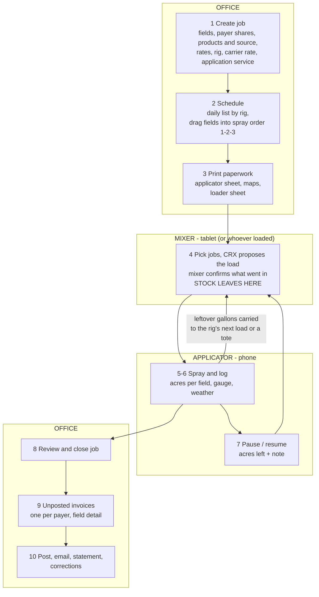
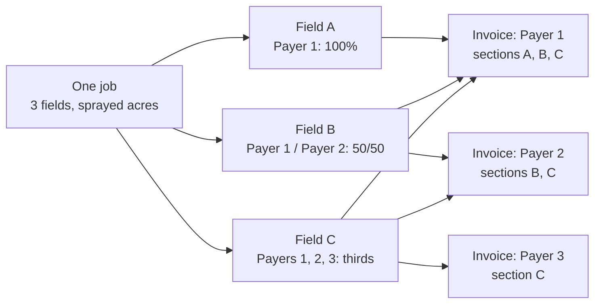

# CRX field application: SPEC (what Mason wants, scheduling to posted invoice)

**Master copy. Every decision here is Mason's newest answer; older answers that conflicted were removed (Mason, 2026-11-24: "my newest answers beat old answer so remove conflicting older answers").** Git history keeps the old versions. If Mason answers something new, change this file in the same PR and delete the answer it replaces.

Other master files: `CONTRACT-who-pays.md`, `CONTRACT-batch-stock.md`, `CONTRACT-field-billing.md` (how money, stock and payers behave), `BUILD-PLAN.md` (order, lanes, gates, what goes live when), `SCENARIOS.md` + `scenarios-calc.py` (the exact numbers). When they disagree, this file wins, then the contracts, then the build plan. Current code says what exists today.

Made-up numbers and names only here; never a real company or person.

**Standing rules (Mason):**
- **Don't over-engineer.** Flags and notes, not blocks. No extra crew or office steps.
- **Field billing follows the chemical-sale billing rules** for rounding and splitting (2026-11-24). Section 9.
- **Core first** (by February 1, 2027), the rest before the April rush. The only reports built are the season acres and blend reports until Mason asks for more [GR12].

Tags like [D1], [GR4] point to the decisions register (section 10). [ENGINEERING] is a technical choice Claude makes. [SPRING] is agreed but not in the February version.

---

## 1. The whole flow

**The three rules everything hangs on:**
1. **Stock leaves once, when a load is confirmed** [D1]. Nothing after that touches stock; it moves *solution* (mixed product already off the shelf).
2. **Bill what actually went in the tank** [D1, 2026-11-24 b]: each load's contents (confirmed mix, adds, corrections, carried in) minus what was carried out or sent to a tote, spread over the fields it sprayed by acres logged, split by each field's payer shares. Never planned acres [M5].
3. **Each payer gets one invoice per job, with field detail inside** [D4, G2]. Loads and tanks are internal.

---

## 2. People and what each one does

| Person | Login | Does | Does not |
|---|---|---|---|
| **Office** (admin, sales rep; the bookkeeper uses an admin login [F1]) | admin / sales_rep | Creates and schedules jobs, prints paperwork, may enter a load for a job with no tablet load, reviews and closes jobs, approves waste [D11], edits and posts invoices. **Any rep may edit any field draft and post any field invoice set** [F2]; commission comes from the rep on each payer's customer record, on that payer invoice's own profit [2026-11-24 e] | — |
| **Mixer** | The mix-site tablet stays signed in on one applicator-role account named for the mix site (no new role) [GR4, ENGINEERING]; the mixer taps their name on each load. If that account is not ready, mixers sign in with their own **applicator** login [2026-11-24 d] | Picks any open job, confirms each load's real contents, edits the load's mix, adds to or corrects a load, logs leftover | Approve waste, see money screens |
| **Applicator** | applicator | Sprays, logs acres per field, gauge, weather, times and crew; pauses with a note; taps Job done [GR3] | Close the job, approve waste, bill |
| **Tender driver** [SPRING] | Any of the four logins [Q5] | Tender and sprayer fills and balances | — |

[ENGINEERING] One shared "office staff" check decides who counts as office in field billing, so a bookkeeper role later is a one-place change [F1]. The mixer name list is active `ground_crew_members` plus active applicator `profiles`; the load keeps the name and the signed-in account.

---

## 3. What CRX keeps a record of

Every record keeps who changed it and when, and **never overwrites history**: corrections are added, not edited over.

| Thing | What it holds |
|---|---|
| **Field** | Boundary, crop (map colour), acres, **payer shares**: a product share set and an application share set, each exactly 100%, with history by start date [A1, Q3]; a plain editable pricing note and general note per payer, outside split history [2026-11-24 g]. Archived, never deleted [Q5] |
| **Job** | Fields with planned acres (editable before mixing) and spray order (`job_fields.sort_order`); products with rate, unit and **sourced from** (CRX stock or a vendor) [2026-11-24 h]; carrier rate (`jobs.carrier_rate_gpa`, finished gallons per acre); rig (`jobs.vehicle_id`); **application service** with its "bills the customer" flag and outside company copied onto the job when picked; tags, job date, dispatch date, notes, prices (locked quote or booking prices carry forward) |
| **Load** (a mixed batch) | Each input: product, amount in stock units, sourced from, stock location; water and finished gallons; carried in from the rig's last load (load and gallons); who mixed (name) and which account confirmed; which job(s); leftover gallons at the end and where they went. **Keeps its own mix forever** [Sol 4]. Added to or corrected only by a new revision with a reason [Sol 31]. **The only event that takes stock** [D1] |
| **Work entry** | Extends today's `job_applied_records` / `job_applied_record_fields`: job, field, the load segments that sprayed it (load revision + acres) [Sol 2], applicator, rig, Central spray date (from the start time), start/end time, acres sprayed, gauge reading when a load finishes ("ran dry" / X gal left) [Q11], weather, crew, restricted-use values as entered, notes; for an unfinished field, acres left + resume note [ops S12] |
| **Legal spray record** | Today's `application_records`, written per field when the office closes the job, from the work entries and load revisions (actual rate, products, vendor-sourced lines included) |
| **Review item** | Why the job needs the office (section 4, stage 8) |
| **Field invoice** (unposted → posted) | One per payer per job: field sections, line items, per-line share overrides, "Shared with" note [Q9], internal note and customer note |
| **Equipment** [SPRING] | Tenders, sprayers, totes with capacity and balances [ops S04–S09] |

---

## 4. Stage by stage

### Stage 1: Create the job (office)

1. Start a job directly or from a sent quote or booking; locked prices carry forward [Q1].
2. **Pick fields by payer:** search a grower and see every field they pay any share of (product or application share above 0); add several growers' fields; earlier picks stay. Pickers show grower name and acres beside each field.
3. The map colours fields by crop with a legend. [SPRING: neighbour toggle]
4. Each chosen field shows its billing split. A field with no split yet starts **100% to the grower it was added under**, so the crew can spray right away; the office can change it before posting [GR5].
5. Planned acres fill in from the field and can be edited before mixing.
6. **Products:** pick from a list; rate, unit and warehouse fill in and can be changed. **Every rate is per acre** (per-100-gal and %-of-tank products are converted by the office) [GR8]; stock and invoice amounts convert through the product's unit and the existing `unit_conversions`. Over the normal or label rate **warns, never blocks** [Sol 1]. Each line has **sourced from**: CRX stock (default) or a vendor. The office sets up a vendor for a grower, another company or the owner's farm company when that party supplied the product; a vendor-sourced line takes no CRX stock and bills $0 [2026-11-24 h]. Credit hold makes no difference to field jobs [GR9].
7. **Rig and carrier rate:** the rig's normal finished gallons per acre (water plus product) fills in and can be changed for this job; every printout and calculation uses the job's value, labelled when changed. Water to add = finished gallons − liquid product gallons; dry products add no volume. If the liquid products alone exceed the finished gallons, water to add prints as 0 with a warning, never a negative number.
8. **Application service** [2026-11-24 f]: the office picks how the job is applied from the existing `application_services` list (our sprayers, side-dress bars, tractors, Terragators, a named custom applicator…), prefilled from the customer's default service. Each service says whether CRX bills the customer for it and, for a custom applicator, which outside company (an existing vendor) did the work; both are copied onto the job when picked. Acres are always logged, billed or not. One service and one rate per job: the job customer's season rate for that service (`customer_application_rates`) if set, else the service's default rate [2026-11-24 i]. **No flat fees and no fuel charge on field jobs** [Sol 67, 2026-11-24 c]. Two rigs billed on one job is later; the design must not rule it out [D7].
9. Tags and job date. Save → **Scheduled**.

### Stage 2: Schedule and dispatch (office)

1. **Daily board: a list by rig**, built by extending `DispatchBoard` (list first; its Map view stays) [Q12]. Filters by tag, date, status; tick several jobs to print or map together. No job priority shown; `jobs.priority` stays in the database.
2. **Spray order:** drag and drop fields into order, numbered 1, 2, 3 **per job** (each job restarts at 1) [Q13, Sol 86], stored in the existing `job_fields.sort_order`. Shown on maps, sheets and the phone.
3. Dispatch date is separate from the job date and the spray (legal) date.
4. Assign applicator(s) and rig; changing the rig later is allowed (it affects future loads only).
5. "Scheduled" does not mean "mixed"; the mixer decides [ops S13].

### Stage 3: Paperwork (office prints)

1. **Applicator sheet:** fields, map pages, directions link, tank contents, safety information. Options: **hide tank contents** (hides amounts and rates; product names and safety stay), **map pages only**. Safety information (REI, PHI, signal word) always prints on every page.
2. **Maps:** combined, per field, or both; field numbers are the spray order. Printing what's in the map window and an ink-saver option are [SPRING].
3. **Loader sheet:** rate per acre, total of each product, **water to add** and **finished gallons** labelled separately [Sol 62], in loader units ("58 GL 7.68 FL OZ"). Views: one big batch, or loads sized to the tank (the existing `job_loader_worksheets` modes).
4. Printed load sheets for anyone on paper; paper work is entered afterwards [G3.1].
5. A product with no EPA registration prints a dash; "Unknown" only when a registered product's number is missing [KI-206].

### Stage 4: Loading (mixer on the tablet, or whoever loaded) — STOCK LEAVES HERE

1. The mixer screen lists open jobs, grouped where the latest mix (products and rate per acre) matches so one load can serve them [ops S10]; differences show as flags. The mixer **picks the job(s)** [ops S13].
2. For each job: acres still to spray and solution still needed.
3. **Leftover from the rig's last load** [GR2]: the gallons logged as left on that rig's last confirmed load show as **carried in**, with that load's mix, and CRX proposes that much less. Only one load can take a carry; a second gets 0 and a flag. Leftover nobody can use goes to a tote and is dealt with outside CRX [Sol 9].
4. CRX proposes the load (each product's amount, water, finished gallons, sized to the tank); the mixer can change it before mixing.
5. **Confirm actuals:** the mixer confirms or types what really went in and taps their name. Then **Add to load** (product really added later) or **Correct load** (a typo, with a reason) [Sol 31].
6. **Stock leaves now, once, from the confirmed amounts** [D1], from each input's warehouse. Vendor-sourced lines take no stock. **Stock short:** the load still saves, stock may go below zero, the office gets a flag [Sol 32]. The job's held stock is released once when the job closes or ends (partial release per load is [SPRING]).
7. **Mix differs from recipe** [Q2]: the mixer can remove, add, substitute or change an amount. The original recipe stays in history; the job is flagged for office review. **Each load keeps its own mix** [Sol 4/5]. A substitute with no price is flagged for the office to price [M9].
8. A load can serve several compatible jobs [ops S10]. A vendor-sourced line used on another customer's job is allowed and flagged [Q3].
9. **Jobs with no tablet load** (custom applicator, Terragator, side-dress, dry product): the same load record, entered by whoever loaded it or by the office; leftover "none" is one tap. One billing rule [2026-11-24 j].

### Stage 5: Tenders and sprayer fills [SPRING]

Tender and sprayer balances, fill to full / partial fill / correct balance, any-container-to-any-container moves of the same mix, totes as containers, one mix per tender, spills recorded as a balance correction with a note [ops S04–S11, Q10, Q14]. Until then the leftover rule in stage 4 step 3 is the whole leftover feature [GR1, GR2].

### Stage 6: Spraying and logging (applicator, phone)

1. Open the job and field. **Now** buttons for start and finish times. Weather fills in for the start time and can be edited [Sol 52]. Directions link to the field.
2. **One work entry per field per day** (unless the office keeps a real second pass): acres sprayed (planned acres pre-filled; saving the entry confirms them; an unsaved field is missing, never planned), rig, crew, comments, and the load segment(s) that sprayed it [Sol 2]. An entry with segments has one acre number: the sum of its segment acres. An entry typed from paper before its load is entered saves with "no load linked", shown on the review list; the office links it before closing. One tankful over several fields: acres per field. Two loads on one field in a day: one entry, two segments. The spray date is the Central date of the start time.
3. **Extra acres** (more than planned) are logged and bill like any sprayed acre; shown to the office for information [Sol 37].
4. **Two entries that look the same** (same job, field and day, for example phone plus paper) warn; the office removes one or keeps it as a real second pass [Sol 28]. **A real second pass bills its own service acres** [M8]. Until the office acts, both entries count (the warning stays on the review list); "remove" marks the entry removed with who and why, it is never deleted.
5. **When a load finishes or the sprayer empties:** gauge reading, "ran dry" or "X gal left" [Q11]; leftover is carried to the rig's next load or a tote [GR2, M4].
6. Anything unusual (drift, wrong field, water-only top-up) is a **note** [Sol 20, 63].
7. Restricted-use products ask for the extra fields staff set per state (the field's state), and the values are saved on the entry as entered [D6, Sol 15]. **The spray record prints per field any time** [Sol 18]: before close it is built from the work entries and load revisions, the same data the close writes.
8. **Extra field** asked for by the grower: the applicator picks it from fields any payer on the job pays on (any payer share above 0) or types a note when it is not there, and logs acres; its payers come from that field's own split; flagged for the office to confirm [GR6]. A note-only entry keeps its acres and note with no field; the office links it to a real field (adding the field first) before closing.
9. **Job done:** any applicator on the job taps it; the job goes to Ready for review, and entries saved later simply show on the review screen. The office can also mark it [GR3].
10. An applicator can fix their own entry until the office closes the job; after that only the office, with a reason [ENGINEERING].
11. Phones work without signal and sync later [Q7] [SPRING].

### Stage 7: Pause and resume

1. An unfinished field: acres done + resume note [ops S12]. **The job stays open across days**; every day adds entries [G1].
2. The job shows planned, sprayed and remaining acres per field and solution still to mix; the next load includes "X acres to finish on field Y" [G1], using the applicator's reported acres left when given (planned minus sprayed otherwise, shown beside it); billing always uses logged acres.
3. **Never sprayed** (rain, grower stops partway): the office **closes the remaining acres with a reason**; they are not billed [D1b, Sol 11]. **Cancel is only for a job with zero acres sprayed and no confirmed load** [Sol 11].
4. **Rained out after mixing:** the office ends the job with nothing billed; the load stays recorded (its stock really left), its leftover can still be recorded as carried or to a tote; a note is optional [M4].

### Stage 8: Office review and closing the job

The job reaches **Ready for review** when Job done is tapped [D8, GR3]. **A clean job closes with one click.**

| Check | Kind | Rule |
|---|---|---|
| **Every field answered** | Needed to close | A field with no record is **missing**. A recorded **0** is a real answer. Closed remaining acres are a third state. Missing never becomes planned acres. |
| **Leftover recorded** | Needed to close | Each load ran dry, or its leftover is carried or to a tote (`none` only for a load with no water). Gauges are rough: **a gap up to and including 5% (office-adjustable) passes with no office step** [Sol 25]. Gap = (expected leftover − gauge leftover) ÷ the load's finished gallons plus carried in, either way; expected leftover = finished gallons + carried in − acres sprayed from the load × the job's carrier rate. |
| **Every entry linked** | Needed to close | An entry with acres has a load segment or a field (the office links "no load linked" and note-only entries). |
| **Label maximum** [G6] | Note needed to close | Checked per field with the load's actual rate on it [Sol 3]. The office writes what happened; the legal record keeps the actual rate. |
| **Shared load** | Needed to invoice, not to close | A job sharing a load with a job still spraying closes; its invoices wait until that load is settled: its leftover recorded and every job on it Ready for review or closed. The office can settle the load by hand with a reason [Sol 6]. |
| **Rate check per load** [G4, Q11] | Flag | Billed vs planned per load and product (planned = each job's own recipe rate × that job's acres from the load, added up); more than **5% (office-adjustable)** of planned either way puts the job on the review list with planned vs billed and the dollar difference. A load shared by jobs gives them one rate. The office can edit a load's used quantity with a reason (measured usage, shown beside the raw amount). Zero-acre jobs skip it. |
| **Mix differed from recipe** [Q2], stock short [Sol 32], possible duplicate entry, extra field, extra acres, unpriced substitute [M9] | Flag | Shown on the review list; the office acts only if it wants to (pricing a substitute is needed before posting, not closing). |
| **Waste** [D11, Q6] | Flag | Approved by any office role with a reason. Not billed unless the office adds it with a reason. |

The office closes the job → **Applied**; the legal spray record is written then. A save, duplicate decision or close all take the job row lock, and close re-reads the job, so a save in flight lands before or after, never half. An optional "job done" email (off by default) goes to every payer, each seeing only their own fields [Q8, D5].

**Office views** [Sol 77, 80]: per job, planned vs mixed vs billed per load and product, differences highlighted; a "sprayed, not billed" list (jobs whose first spray day is before the switch-on date, and jobs marked billed in Chem Man, count as billed and are left off, counts included).

### Stage 9: Unposted invoices (CRX builds, office reviews)

1. **Made only when the job is closed** and every load it shares with another job is settled [G2, Sol 6], and only for a job whose first spray day is on or after the billing switch-on date [M5]. One unposted invoice per payer, listing every field that payer shares on the job [D4].
2. **How each line is worked out** (exact numbers: `SCENARIOS.md`):
   - **Quantity: bill what actually went in the tank** [2026-11-24 b]: a load's billed amount of each product = what was put in it (confirmed mix, adds, corrections, plus anything carried in) minus what was carried out or sent to a tote, spread over the fields the load sprayed by the acres logged on each. The recipe is the plan and the 5% check only. Service = the field's sprayed acres, only when the job's application service bills the customer [Sol 68]. Each real pass counts [M8].
   - **Price:** locked quote or booking prices carry forward. Otherwise **one price per product for the whole job**: the product's price copied onto the job's line on the first spray day. No single-field price and no per-payer price in February [M2]. The service rate (stage 1 step 8) is copied the same first spray day, one rate per job; a logged price refresh moves it like product prices. A substitute with no price holds the whole payer set until the office prices it [M9]. Line by line, never a flat price per acre.
   - **Money, the chemical-sale way** [2026-11-24 a]: each product is priced **once per job** (total quantity × price, rounded to the cent once), and all lines add up to that once-rounded amount (1 gal at $10.01 over two equal fields bills $5.01 + $5.00). That total is shared across the fields; then each field line is shared across its payers **exactly as chemical-sale split invoices do**: every payer except the main customer gets their share rounded down, and **the main customer (the job's grower) gets the rest**; if the main customer has no share of that line, the largest share gets it.
   - **Shares:** products use each field's **product shares**; service uses its **application shares** [A1, Q6]. The split is the one **in force on the day that field was sprayed** [Sol 41].
   - **No flat fees, no fuel charge, no sales tax on field work** [Sol 67, Sol 48, 2026-11-24 c]. Vendor-sourced lines print at $0, never touch company stock, and still show line by line on the load, spray record, invoice and blend report [2026-11-24 h].
   - **Notes:** each payer's invoice has an **internal note** (office only, never printed or emailed; the existing `invoices.internal_notes`) and a **customer note** that prints (the existing `header_notes` / `footer_notes`, as on chemical invoices). Notes stay with that payer's invoice through saves, unpost and repost, and carry to a replacement invoice [2026-11-24 g].
3. **Each invoice shows** field sections (name, acres, rate per acre, spray dates), lines labelled **"field total"** and **"your share"**, a **"Shared with"** note, and only that payer's fields; never other payers' prices or CRX's cost [Q9, Sol 71]. **A payer whose total is $0 gets no invoice**; their lines stay recorded [2026-11-24 e].
4. **Office edits before posting** (any rep or admin [F2]):
   - Per-line share override (for example one payer 100% of one product); payers can only be those on the field's split or the job's office split [Q1]; every payer's cents still add up to the line.
   - Quantity edits **with a reason** [D9, B03]. **Price edits with a reason apply to that product on the whole job** (one price per product per job).
   - **Prices stay fixed** once the draft is made; an explicit, logged **price refresh** moves them to today's price and never touches locked quote or booking lines or an office-edited price [B02, Sol 43].
   - A field's split changed after the draft was made reaches the draft only through a logged **split refresh** [Q3]. Work changed after the draft (a load correction, a new entry on a shared load) flags the draft; a refresh brings it in.
5. **Invoice date** defaults to the posting day; the office can set it earlier before posting. Due date follows each payer's terms; date, season, terms, due date and rep are fixed at posting [GR7].
6. Print options: maps on or off, ink saver, colour [SPRING].
7. **Overlap warning:** a hand-typed invoice naming the same field, application date and product as a job warns; a note is optional [B04]. Billing the same job's work twice is refused.

### Stage 10: Post, send, statements, corrections

1. **Post** the payer set: any admin or sales rep [F2]. **The whole set posts or none of it does** [Sol 13], the same way chemical-sale split groups post.
2. Print or email each payer's invoice (email only [D5]); it shows on that payer's monthly statement.
3. **Corrections** [D9, Q10]:
   - **Unposted:** edit with a reason.
   - **Posted, no money applied, month open:** unpost the **whole payer set**, fix, repost, with a reason. "No money" = no payment, prepay, credit or write-off on any invoice in the set [Sol 45]. Any invoice whose printed amount changes is marked **"Corrected"**; the office chooses whether to re-send [M3].
   - **After money or month close:** as chemical sales do today: credit what is left on each invoice whose dollars changed, rebill it; a payment stays with that customer and is applied to the new invoice. A payer who drops to $0 gets only the credit; a payer who newly owes gets a new invoice in the set [M3, 2026-11-24 e].
   - Correcting a posted job's spray record flags its invoices; it changes nothing by itself [Sol 47]. The legal record gets a corrected version; the original stays readable.
   - Stock is corrected only by a new reversing entry. Field invoices take no product returns.
4. **First real multi-payer job:** drafted and checked by hand with the checklist in `SCENARIOS.md`; with Mason's yes posting is switched on for that one set only; posted and checked on statements; then, with Mason's second yes, posting is on for everyone [D12].

### Going live [2026-11-24 k]

1. **Order:** Taha's one-time live reset → slice 1 → slice 2 (Taha's areas only after 2026-12-15, with his review) → slice 3 → switch-on date set → first real multi-payer job drafted, checked by hand, posted alone → billing on for everyone. No field-app migration is applied live before the reset has run.
2. **Chem Man keeps billing field work until the whole field app is live; then Mason sets the billing switch-on date.** No job straddles it; a job whose first spray day is before it is billed in Chem Man and never in CRX; the date is absolute, with no exception [M5, GR11]. CRX never bills planned acres.
3. **Fields from Chem Man:** imported **once**, from Mason's export file. Fields already in CRX (same customer and field name) are skipped and listed for the office. Trial run on a local test copy of the database, not staging; then imported live once, after Taha's reset, with Mason's yes, and checked by hand [GR10, 2026-11-24 l].
4. **Open jobs at the switch-on:** Mason picks the date from the open-job list so no job is mid-work. Any job open at the switch is finished and billed in Chem Man; a Chem Man job not yet sprayed is re-created as a CRX job by hand [GR11].
5. Old test jobs were deleted by Taha's reset; real jobs are archived [D12].

---

## 5. Job status

Stored values stay as today plus one: `scheduled` → `in_progress` (first load or work entry; Paused is `in_progress` with a resume note) → `ready_for_review` (new; Job done) → `completed` (shown as **Applied**; closed by the office, or ended with nothing billed) → `invoiced` (set when its payer set is made, as the transfer does today; unposted vs posted is read from the invoices). "Needs office decision" is a review-list flag, not a status. A posted set can go back to unposted (no money, month open). Readers of `completed` (hold release, `completed_at`, applicator access, reports) keep working because the stored value is unchanged; `ready_for_review` stamps nothing.

`cancelled`: only with zero acres sprayed and no confirmed load [Q9, Sol 11]. Rained out after mixing: ended with nothing billed [M4]. Stopped partway: remaining acres closed, then review and billing.

---

## 6. Worked example (made-up numbers)

Job: fields A (51 acres, 1 payer), B (110 acres, 50/50), C (71 acres, thirds). Product X at 32 fl oz/acre, carrier 15 finished gal/acre (water plus product).

1. **Mix:** CRX proposes 58 gal X + 3,422 gal water = 3,480 finished gallons (232 planned acres × 15). The mixer confirms. **Stock −58 gal X.**
2. **Spray:** A 49 acres, B 110, C 69 = 228. Ran dry.
3. **Rate check:** 58 gal over 228 acres = 1.75% over plan, under 5%: no review.
4. **Bill:** the 58 gal of X that went in the tank, at one price, priced once for the job, spread across A, B, C by acres, then across each field's payers. The review screen shows planned 57, mixed 58, billed 58.
5. **Invoices:** three, one per payer; payer 1's has three field sections. Exact cents: `SCENARIOS.md` S1.

---

## 7. Feature list: February vs spring

**February (core, GR1):** stages 1–4 (no partial hold release), 6 (no offline), 7, 8, 9, 10, going live. Field picker by any payer share; drag-and-drop spray order; job carrier rate and rig default; paperwork fixes; mixer tablet with name pick, per-load mix edits, add/correct, leftover carried to the rig's next load; loads entered by the office for no-tablet jobs; stock at the load; product "sourced from"; work entries per field per day with Now buttons, weather, gauge, duplicate warning, extra field, restricted-use fields, Job done; review checks and office views; per-payer invoices the chemical-sale way; posting as a set; corrections; Chem Man until the switch-on date; application service per job (billed or not, custom applicators); season acres report and blend report (S34); optional job-done email.

**Spring, before April:** tender and sprayer balances, fills and moves, totes as containers, offline phones, per-payer prices on one field [M2], leftover claim tracking (carried mix checked against the next job's recipe and customer), exact carried composition after water top-ups, partial hold release per load, a possible-duplicate-load flag, crop-coloured map neighbour toggle, map print options, blend-ticket billing on the same rules, orders and deliveries reading field shares.

**Later:** two rigs billed on one job (D7), applicator licence per entry, sensitive wind direction, power and tree lines, map export, sensitive-crop layer, text messages, bookkeeper role (F1), a separate mixer role, other reports [GR12].

---

## 8. Behind the scenes (Claude owns these)

1. One quantity calculation (`field_job_usage`, built in the review-checks PR) and one billing calculation for every route that bills field work.
2. Every save is retry-safe: a double tap or resend never makes two loads, two stock moves or two invoices; the screen keeps its key across retries.
3. Rules and access are enforced in the database, not only on screen.
4. Real billing stays off in production until every scenario in `SCENARIOS.md` passes on staging as the real roles; the first real job is checked by hand.

---

## 9. Same rules as chemical sales (Mason, 2026-11-24)

Field invoices use the chemical-sale split rules already live in CRX (`_bill_split_line_shares`, `20261215110000`, applied 2026-11-09), so a customer sees one way of rounding:
- A line is quantity × price, rounded to the cent once.
- Each payer except the main customer gets their share **rounded down**; the main customer gets the rest. If the main customer has no share of a line, the largest share gets the rest.
- A payer's quantity is rounded down to hundredths (4 decimals for a share under 0.01, and for negative quantities) the same way, the main customer taking the rest.
- Ties for the largest share go to the lowest customer id. Credits (negative amounts) round every other payer's share down, away from zero, and the main customer takes the rest.
- The payers' invoices are one group: they post, unpost and are deleted together.
- A line with no price holds the group.

Field-only differences, each Mason's own answer or a consequence of one: field shares are stored exactly (thirds are 33.333334% / 33.333333% / 33.333333%); the job's customer (the grower) is the main customer; a product over several fields is priced once for the job and then shared across the fields the same round-down way; no sales tax and no flat fee on field work; any rep may post a field set; an unpriced substitute drafts the set and holds posting (chemical sales draft nothing until priced); a share too small for 0.0001 of a unit keeps its cents with quantity 0 instead of refusing.

---

## 10. Decisions register (newest answer only)

Sol numbers without a row here are reviewer finding ids kept for traceability; the sentence they tag is the rule.

| ID | Decision |
|---|---|
| D1 | Stock leaves once, at load confirmation, from the confirmed amounts. Bill what went in the tank (2026-11-24 b) |
| D1b | Acres never sprayed are closed by the office with a reason and not billed |
| D4 | One invoice per payer per job, field detail inside |
| D5 | Email only |
| D6 | Restricted-use extra fields set by staff; keep it small |
| D7 | One service charge and one rig per job for now; don't rule out two |
| D8 | Applicators mark the job done; the office reviews, closes and posts |
| D9 | Draft: edit with a reason. Posted: unpost the whole set while no money and month open. After that: credit and rebill |
| D11 | Waste approved by admin or rep (the bookkeeper uses an admin login). A real second pass is M8 |
| D12 | Test jobs were deleted by Taha's reset; real jobs archived. First real multi-payer job checked by hand |
| F1 | No bookkeeper role yet; admin login |
| F2 | Any rep edits and posts any field invoice set |
| G1 | Unsprayed acres stay on the same job across days |
| G2 | Invoices when the whole job is closed; none mid-job |
| G3.1 | Mixer works on a tablet at the mix site; loads also print |
| G4 | 5% rate check per load; per-load numbers shown |
| G6 | Over label max: office writes what happened; the legal record keeps the truth |
| A1 | Each field has product shares and application shares, each exactly 100%; a payer may be 0% on one side |
| B02 | Draft prices stay; only a logged price refresh changes them |
| B03 | The office may enter measured usage with a reason |
| B04 | A hand-typed invoice overlapping a job warns; a note is optional |
| Q1 | Payers on a field come only from its saved split (or a job's office split); add someone to the field first. Jobs start directly or from a quote or booking |
| Q2 | Mixer edits the load's mix; the job is flagged; bill what went in the tank |
| Q3 | A field's split can change from any date the office picks; drafts keep theirs until a logged refresh. A vendor-sourced line on another customer's job: allowed, flagged |
| Q5 | Fields: admins and reps archive, only admins restore, blocked while work is open. Tender driver: any login [SPRING] |
| Q6 | Wasted solution not billed unless the office adds it; never just dumped |
| Q7 | Offline phones sync later; a job can't close while entries wait [SPRING] |
| Q8 | Optional "job done" email, off by default, to every payer, own fields only |
| Q9 | Each payer's invoice shows who shares the bill. Cancel only at zero acres sprayed |
| Q10 | A posted set can be edited (unpost, fix, repost) until money is applied or the month is closed |
| Q11 | A shared load's use is split across its jobs by acres |
| Q12 | Daily board is a list by rig; Map view kept, list first |
| Q13 | Drag-and-drop spray order 1, 2, 3 per job; no priority |
| Q14 | No spill button |
| S01–S16 | Codex's operating answers (each applicator logs their own work; same job across days; tenders carry one mix; mixer picks jobs; loads can serve several compatible jobs) |
| Sol 4/5 | Each load keeps its own mix; each field bills the loads that sprayed it |
| Sol 6 | Shared load: invoices wait until it is settled; office can settle it by hand |
| Sol 9 | Unusable leftover goes to a tote, handled outside CRX |
| Sol 11 | Grower stops partway: close the remaining acres |
| Sol 25 | Gauge gaps up to 5% pass with no office step |
| Sol 32 | Stock short: allow and flag |
| Sol 37 | Extra acres bill as sprayed, no office check |
| Sol 41 | Split on the day sprayed; editable before posting |
| Sol 47 | A spray-record correction after posting flags invoices; it changes nothing by itself |
| Sol 48 | No sales tax on field work and no tax checkbox, unlike chemical sales |
| Sol 66 | One price from the first spray day; locked prices win |
| Sol 67 | No flat fees |
| Sol 86 | Field numbering restarts per job |
| GR1 | Core by February 1; tenders, balances, offline, totes before April |
| GR2 | Leftover logged at the end; the rig's next load shows it as carried in |
| GR3 | Any applicator on the job taps Job done; office can too |
| GR4 | Tablet stays signed in; mixer picks their name |
| GR5 | No split: 100% to the grower the field was added under |
| GR6 | Applicator adds an extra field on the phone; flagged |
| GR7 | Invoice date = posting day; office can set an earlier date before posting |
| GR8 | Every rate entered per acre |
| GR9 | Credit hold ignored for field jobs |
| GR10 | Fields imported once from a Chem Man export file (2026-11-24 l) |
| GR11 | Sprayed Chem Man work billed in Chem Man; unsprayed acres become CRX jobs |
| GR12 | Only the season acres and blend reports until Mason asks for more |
| M2 | Per-payer prices wait for spring; February bills one price per product per job |
| M3 | An invoice whose printed amount changed is marked "Corrected"; office chooses to re-send; credit and rebill only when dollars changed |
| M4 | Rained out after mixing: ended with nothing billed; load stays; contents carried or to a tote |
| M5 | Chem Man bills field work until the switch-on date; never bill planned acres |
| M6 | Sol capped at two rounds per plan; the lane fixes findings itself; disputed ones and ones adding a crew or office step go in the slice's Mason batch |
| M7 | No build session starts until Mason says so |
| M8 | Each real pass bills its own service acres; look-alike entries warn |
| M9 | A substitute with no price holds the whole payer set |
| 2026-11-24 a | Rounding and splitting follow chemical sales (section 9); all lines add up to the once-rounded job amount per product |
| 2026-11-24 b | Bill only what went in the tank (load contents incl. adds, corrections, carried in, minus carried out or to a tote), spread over fields by acres logged; the recipe is plan + 5% flag only |
| 2026-11-24 c | One price per product per job; no single-field price in February; no fuel charge |
| 2026-11-24 d | If the mixer tablet account is late, mixers use their own applicator logins |
| 2026-11-24 e | A $0 payer gets no invoice, but work and lines are always recorded. Paid-invoice corrections work as chemical sales: credit the old, the payment stays with the customer and is applied to the new invoice. Commission: each payer invoice pays its own rep on its own profit |
| 2026-11-24 f | Application service per job from `application_services`, each "bills the customer" yes/no and an optional outside company (existing vendor). Acres always logged. Season acres and blend reports in scope |
| 2026-11-24 g | Split payer notes are a plain editable note outside split history. Invoices: internal note (`invoices.internal_notes`) and customer note (header/footer notes) |
| 2026-11-24 h | Every product line has "sourced from": CRX stock (default) or a vendor; a vendor-sourced line takes no stock, bills $0 and is kept line by line. Replaces the old customer-supplied checkbox. No customer-to-vendor link, no prepay draw-down. All product bills, the owner's own farm included (a normal customer), unless vendor-sourced |
| 2026-11-24 i | Service rate: the job customer's season rate if set, else the service's default; one rate per job |
| 2026-11-24 j | Jobs with no tablet load use the same load record, entered by whoever loaded it or the office; one billing rule |
| 2026-11-24 k | Billing switch-on date is absolute, set once the whole field app is live; no job straddles it; the job-level "billed in Chem Man" mark is enough. Go-live order as section 4 › Going live. No field-app migration applied live before Taha's reset. The kit merges into staging before any build session |
| 2026-11-24 l | Chem Man import: once; fields already in CRX skipped and listed; trial on a local test copy, not staging; live once after the reset; checked by hand |
| 2026-11-24 m | Staging-only migrations count as current work: slice 0 checks each read-only; ones that fit ride the normal release; a conflicting one gets a replacement migration; Mason is asked only if one changes today's live billing |
| 2026-11-24 n | Approvals come to Mason in one batch per slice, every gate listed up front |
| KI-206 | No EPA registration prints a dash |
